# Carte vivante

**Une carte 3D interactive de la France, avec une trentaine de couches en temps réel et de gros jeux de données : trains, avions, bateaux, météo, population, immobilier, élections, couverture mobile… et une frise du temps qui rejoue le passé.**

[](https://github.com/LM28000/openstreetmap/actions/workflows/ci.yml)
[](LICENSE)

> **In English.** *Carte vivante* ("living map") is an interactive 3D map of France with about 30 live and big-data layers: trains placed on real tracks from SNCF timetables and real-time delays, aircraft (ADS-B) and ships (AIS) as 3D models, weather, population grids, property prices, election results, mobile coverage, and a time slider that replays the past from server-side recordings. It is built with TypeScript, React 19, MapLibre and deck.gl on the front end, and a Rust (axum) server that ingests the data, computes public-transport isochrones (RAPTOR) and serves its own vector-tile engine (MVT and PMTiles). Documentation is in French. The MIT licence covers the code only; every dataset keeps its own licence.

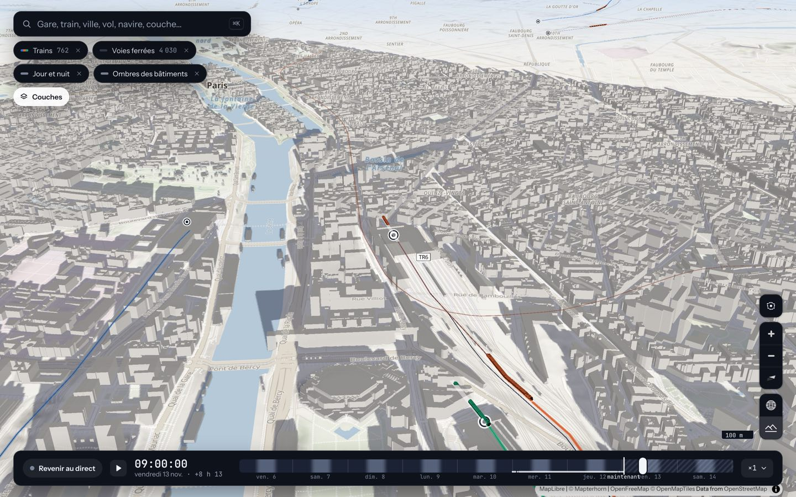

Projet personnel, né pour apprendre : une carte où tout se déplace, où l'on peut remonter le temps, et où les gros jeux de données (2,3 millions de carreaux de population, 3,7 millions de ventes immobilières, des polygones par bureau de vote) restent fluides parce que le serveur les prépare en tuiles.

## Sommaire

- [Ce que l'on y trouve](#ce-que-lon-y-trouve)
- [Technologies](#technologies)
- [Démarrage rapide](#démarrage-rapide)
- [Architecture](#architecture)
- [Documentation](#documentation)
- [Données et licences](#données-et-licences)
- [Contribuer](#contribuer)
- [Licence](#licence)

## Ce que l'on y trouve

L'écran a quatre zones fixes : la recherche universelle en haut à gauche (`⌘K` ou `/` : ville, adresse, gare, train, vol, navire, couche, date), les pastilles des couches affichées, la fiche de l'objet choisi à droite, et la frise du temps en bas (de −7 jours à +2 jours). L'adresse de la page garde tout (vue, couches, réglages, instant, objet choisi) : un lien partagé rouvre exactement la même carte. Une visite guidée de trois minutes présente les temps forts. Voir [docs/utilisation.md](docs/utilisation.md).

La liste complète des 30 couches, avec leur source, leur rythme de rafraîchissement et leurs réglages, est dans [docs/couches.md](docs/couches.md).

### Transports en temps réel

Trains SNCF placés sur les vraies voies (profil de vitesse réaliste, retards en temps réel, trajet et arrêts au clic), bus, trams et métros de ~140 réseaux, métro et RER d'Île-de-France, vélos en libre-service, trafic routier.

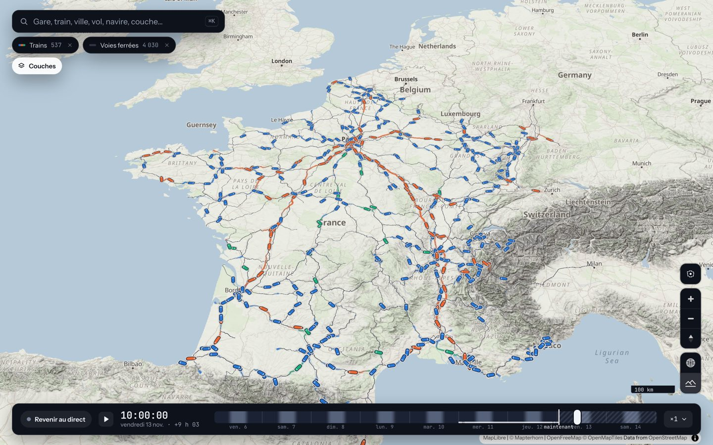

### Ciel et mer

Avions (ADS-B) et navires (AIS) en maquettes 3D construites dans le code, à leurs dimensions réelles de près, éclairées par le vrai soleil ; satellites calculés dans le navigateur (SGP4).

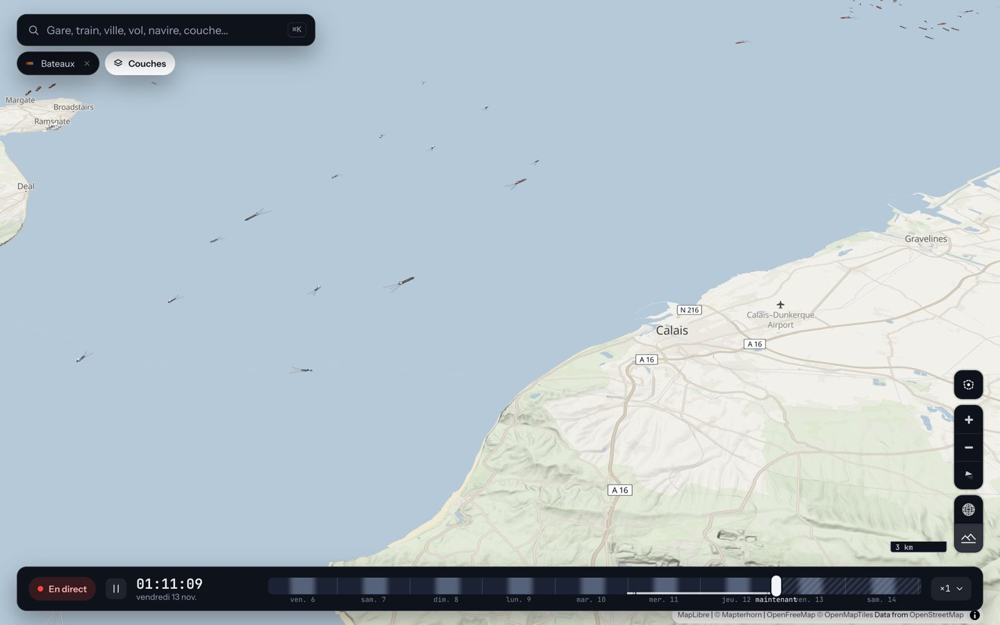

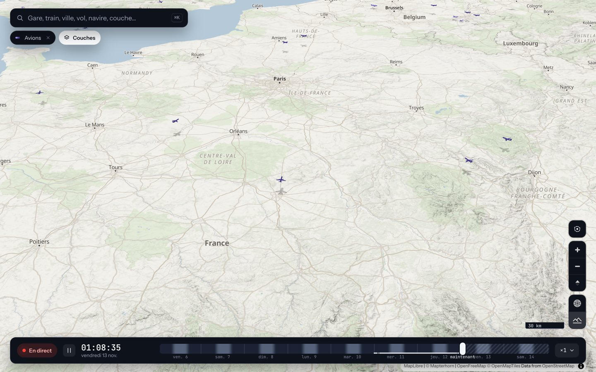

### Météo et environnement

Vent animé, radar de pluie, vigilance météo et crues, qualité de l'air, marées, feux détectés par satellite, séismes, jour et nuit réels avec ombres des bâtiments.

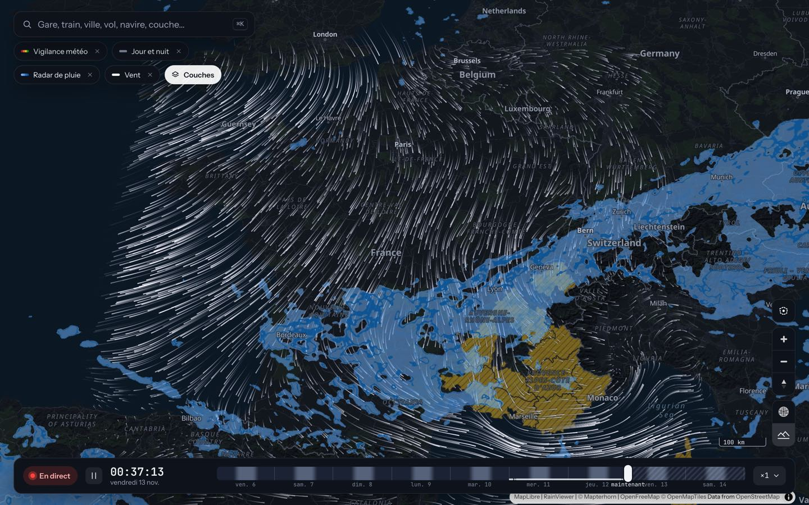

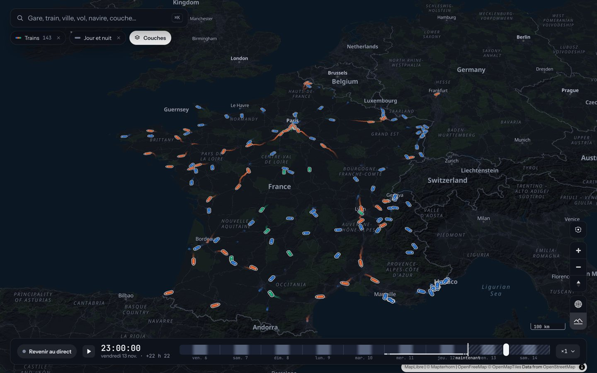

### Territoire et gros volumes de données

Population au carreau de 200 m, prix de l'immobilier (DVF), résultats électoraux par bureau de vote, couverture mobile 4G, accidents de la route, monuments historiques, relief LiDAR HD. Ces jeux sont préparés une fois par le serveur, généralisés par zoom et servis en tuiles vectorielles ([moteur de tuiles](docs/moteur-de-tuiles.md)).

| | |
|---|---|
| 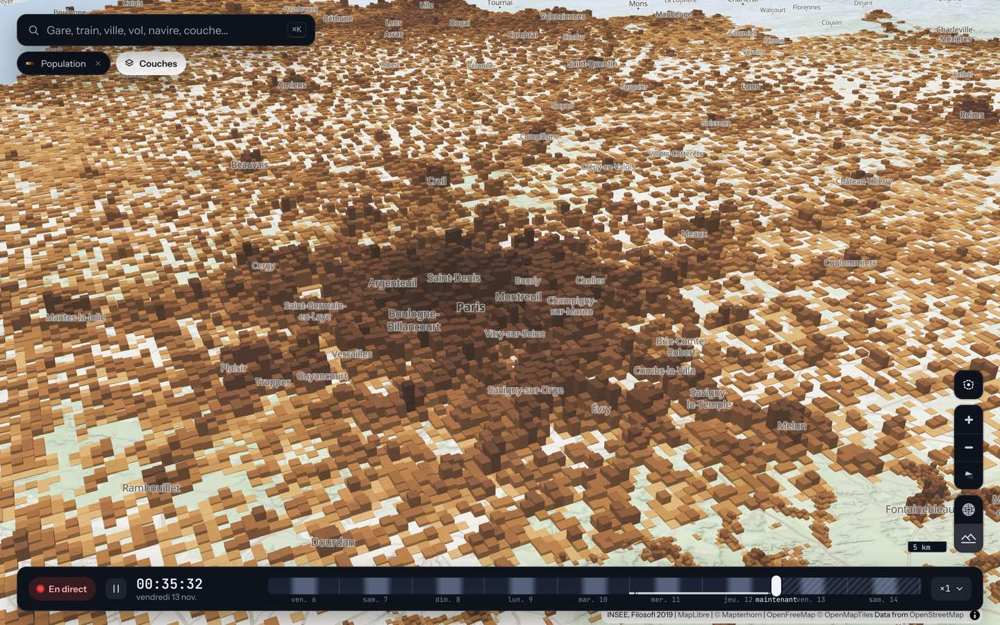 | 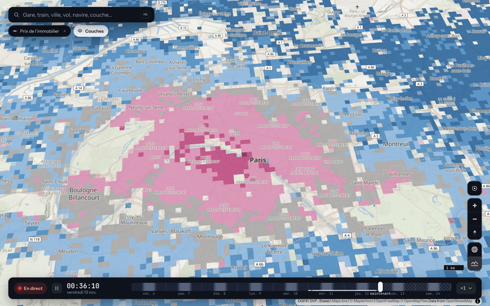 |
| 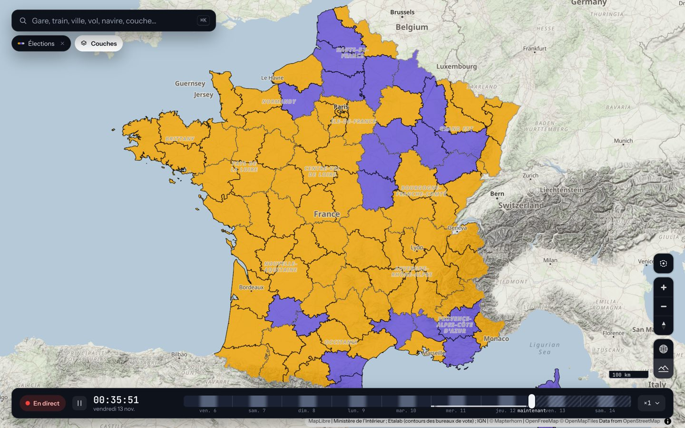 | 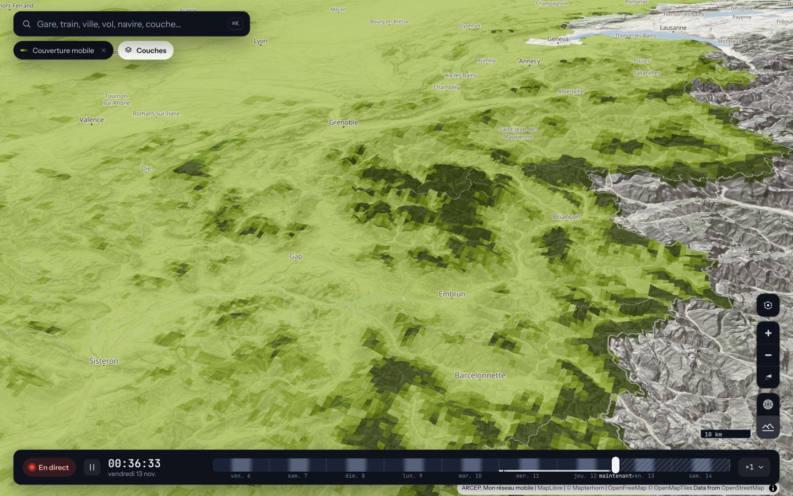 |

### Le temps : relecture du passé et photos anciennes

Chaque couche répond à une seule question : *quel est ton état à l'instant t ?* Faire glisser la frise rejoue donc le passé : le serveur enregistre les positions des avions, bateaux, bus, trams et métros, et les retards des trains. Les photos aériennes de l'IGN, des années 1950 à aujourd'hui, se comparent à la carte actuelle avec un rideau avant / après. Voir [docs/historique-et-relecture.md](docs/historique-et-relecture.md).

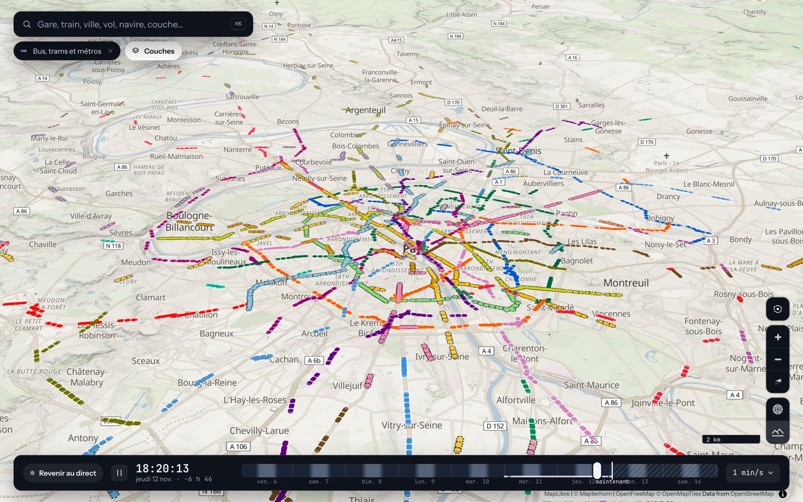

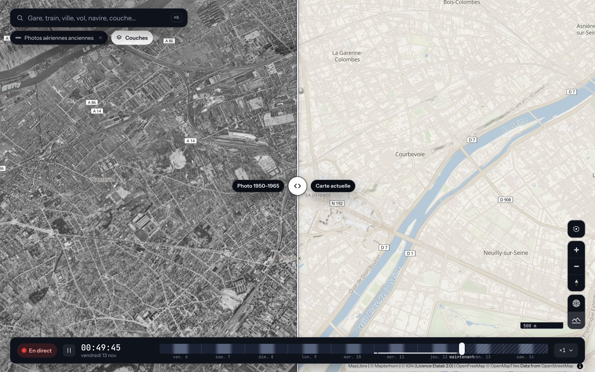

### Analyse

Les **isochrones** (algorithme RAPTOR, trains, cars et métro) montrent jusqu'où l'on va depuis une gare et combien d'habitants sont à portée. L'**analyse de zone** dessine un cercle ou un polygone et croise population, immobilier, couverture 4G, élections, accidents, monuments et gares.

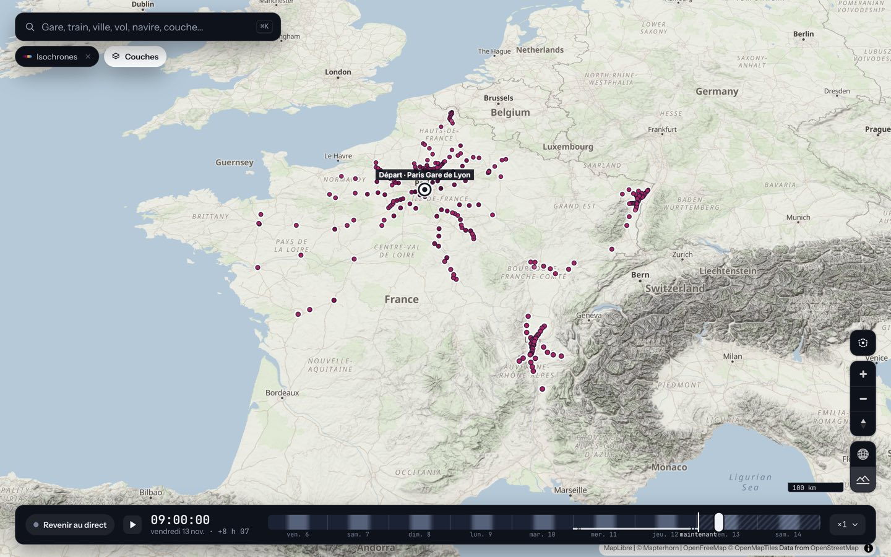

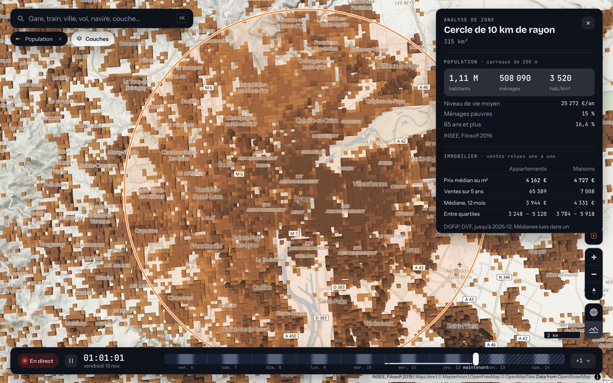

Voir [docs/isochrones.md](docs/isochrones.md) et [docs/analyse-de-zone.md](docs/analyse-de-zone.md).

### Sur téléphone

Tout passe dans une feuille qui monte du bas, à trois hauteurs.

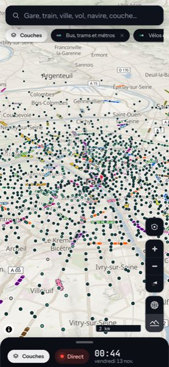

## Technologies

| | |
|---|---|
| **Site** (`web/`) | TypeScript, React 19, [MapLibre GL JS](https://maplibre.org) 5.24 (fond de carte, relief, globe), [deck.gl](https://deck.gl) 9.4 (couches de données et maquettes 3D), satellite.js (orbites), Vite 8 |
| **Serveur** (`server/`) | Rust (édition 2024), tokio, axum 0.8, reqwest ; GTFS et GTFS-RT, RAPTOR, A\*, moteur de tuiles MVT et PMTiles écrit à la main, SQLite embarquée (GeoPackage de l'ARCEP) |
| **Déploiement** | Docker (image multi-étapes, conteneur en lecture seule sans privilège), pnpm 12, Node 24 |
| **Intégration continue** | GitHub Actions : typage et construction du site, tests du serveur |

Le projet a volontairement très peu de dépendances : le protobuf du temps réel, le format MVT, l'archive PMTiles et les projections cartographiques sont écrits à la main.

## Démarrage rapide

### Développement : deux commandes

```bash
cd server && cargo run --release       # terminal 1 : l'API sur http://127.0.0.1:8787
cd web && pnpm install && pnpm dev     # terminal 2 : la carte sur http://localhost:5173
```

Au premier démarrage, le serveur télécharge environ 350 Mo de données dans `data/` (horaires SNCF, voies OpenStreetMap, relief) : comptez quelques minutes. Aucune clé d'API n'est nécessaire ; les couches qui en demandent (bateaux, qualité de l'air, transports d'Île-de-France) sont simplement désactivées. Sans le serveur, la carte s'ouvre quand même. Pour interroger un serveur installé ailleurs : `CARTE_API=http://<adresse>:8787 pnpm dev`.

Détails, vérifications et outils : [docs/developpement.md](docs/developpement.md).

### Déploiement : Docker

```bash
git clone https://github.com/LM28000/openstreetmap.git carte-vivante && cd carte-vivante
mkdir -p data archive                  # avant le premier démarrage (sinon Docker les crée au nom de root)
cp .env.example .env                   # facultatif : adresse d'écoute, clés des couches qui en demandent
docker compose up -d --build           # le serveur sert aussi le site, sur http://127.0.0.1:8787
```

L'image contient le serveur et le site construit. Elle archive le temps réel et enregistre l'historique dans `archive/`. Variables d'environnement, mémoire, volumes : [docs/deploiement.md](docs/deploiement.md).

## Architecture

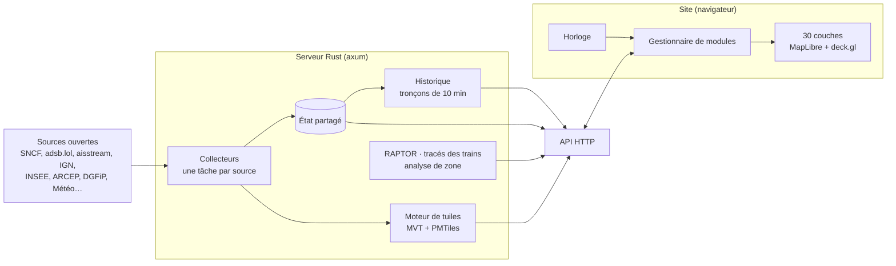

Deux idées structurent le code : **le temps est au cœur du système** (une horloge globale, chaque couche répond à « quel est ton état à l'instant t ? », ce qui rend la relecture du passé et l'accélération du temps gratuites pour les couches) et **chaque couche est un module** (source de données, rafraîchissement, affichage et fiche au clic, avec un gestionnaire qui s'occupe du reste). Détails : [docs/architecture.md](docs/architecture.md).

## Documentation

| Document | Contenu |
|---|---|
| [docs/utilisation.md](docs/utilisation.md) | Interface, raccourcis, visite guidée |
| [docs/architecture.md](docs/architecture.md) | Modules du serveur et du site, système de couches, flux de données, ajouter une couche |
| [docs/couches.md](docs/couches.md) | Chaque couche : ce qu'elle montre, source, rafraîchissement, réglages |
| [docs/sources-et-licences.md](docs/sources-et-licences.md) | Chaque jeu de données : licence, attribution, conditions de réutilisation |
| [docs/moteur-de-tuiles.md](docs/moteur-de-tuiles.md) | MVT, PMTiles, généralisation, ajouter un jeu de données ; population, couverture mobile, immobilier, élections |
| [docs/isochrones.md](docs/isochrones.md) | RAPTOR, isochrones multimodales, habitants atteints |
| [docs/analyse-de-zone.md](docs/analyse-de-zone.md) | Analyse d'un cercle ou d'un polygone |
| [docs/historique-et-relecture.md](docs/historique-et-relecture.md) | Enregistrement et relecture du passé |
| [docs/rendu-3d.md](docs/rendu-3d.md) | Maquettes, éclairage, ombres, performances |
| [docs/deploiement.md](docs/deploiement.md) | Docker, variables d'environnement, mémoire, volumes |
| [docs/developpement.md](docs/developpement.md) | Installation, tests, délai de 24 h des dépendances, approche qualité |
| [docs/feuille-de-route.md](docs/feuille-de-route.md) · [CHANGELOG.md](CHANGELOG.md) | Phases du projet et journal des changements |

## Données et licences

La carte affiche des données ouvertes de nombreuses sources, chacune avec sa licence : OpenStreetMap (ODbL), SNCF et Île-de-France Mobilités (ODbL), IGN (Licence Etalab 2.0), INSEE, ARCEP, ministère de l'Intérieur et ministère de la Culture (Licence Ouverte), DGFiP (DVF), ONISR, Shom, Météo-France via Open-Meteo, RainViewer, adsb.lol (ODbL), aisstream.io, CelesTrak, NASA FIRMS, Atmo France. Le crédit de chaque couche s'affiche dans le panneau des couches, et ceux du fond de carte en bas à droite de la carte.

Deux conditions à connaître avant de réutiliser ou de déployer :

- les **prix de l'immobilier** (DVF) ne doivent être ni ré-identifiés ni indexés par les moteurs de recherche (le serveur applique des mesures techniques à cet effet) ;
- l'**API gratuite d'Open-Meteo** (couche « Vent ») est réservée à un usage non commercial.

Tableau complet, conditions et attributions : [docs/sources-et-licences.md](docs/sources-et-licences.md).

## Contribuer

Les idées de couches, corrections et améliorations sont les bienvenues : voir [CONTRIBUTING](.github/CONTRIBUTING.md). Pour signaler une faille de sécurité et savoir comment les clés sont gérées : [SECURITY](.github/SECURITY.md). Les clés d'API ne sont jamais versionnées (`.env` est ignoré ; modèle dans [`.env.example`](.env.example)).

## Licence

Le **code** de ce dépôt est publié sous licence [MIT](LICENSE) © 2026 Louis-Marie Perret du Cray.

Cette licence couvre **le code uniquement**. Les **données** affichées par l'application (cartes, horaires, positions, statistiques…) ne sont pas redistribuées avec le dépôt et **gardent leurs propres licences et attributions**, affichées dans l'application et détaillées dans [docs/sources-et-licences.md](docs/sources-et-licences.md).
