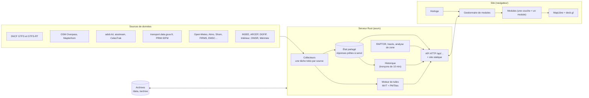
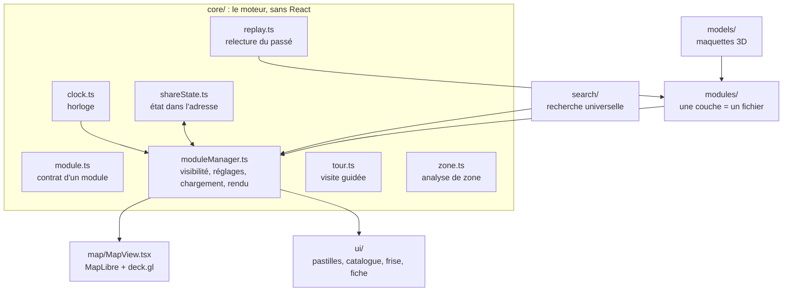
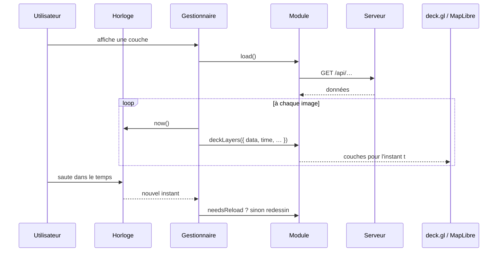

# Architecture

Vigie est composée de deux programmes :

- un **site** (`web/`) en TypeScript, React 19, MapLibre GL JS 5.24 (fond de carte, relief, globe) et deck.gl 9.4 (couches de données, maquettes 3D), construit avec Vite ;
- un **serveur** (`server/`) en Rust (édition 2024, tokio, axum), qui collecte et prépare les données, calcule (tracés de trains, isochrones RAPTOR, analyse de zone), enregistre l'historique, fabrique et sert ses propres tuiles vectorielles, et sert aussi le site construit.

Le navigateur contacte directement quelques services ouverts sans clé : le fond de carte (OpenFreeMap), le relief (Mapterhorn), l'IGN Géoplateforme (photos anciennes, LiDAR HD, géocodage), RainViewer, Vigicrues, ODRÉ (éCO2mix), l'EMSC (séismes) et data.economie.gouv.fr (carburants). Toutes les autres sources passent par le serveur, qui garde les clés.

## Vue d'ensemble



## Le serveur (`server/src/`)

`main.rs` charge les horaires SNCF, puis lance une tâche tokio de fond par source (`poll_forever`), qui remplace d'un bloc la réponse prête à servir dans l'état partagé (`state.rs` : `Arc` remplacé, jamais modifié sur place, donc une requête garde une vue cohérente). L'API (`api.rs`) ne fait que servir ces réponses ; le moteur de tuiles, l'historique et l'analyse ont leur propre routeur.

| Module | Rôle |
|---|---|
| `timetable.rs` | Horaires théoriques SNCF (GTFS) : téléchargement, modèle compact en mémoire. |
| `realtime.rs`, `gtfs_rt.rs` | Retards en temps réel (GTFS-RT, protobuf déclaré à la main) : relevé régulier, archivage. |
| `rails.rs`, `tracks.rs`, `dem.rs`, `network.rs` | Voies OSM (Overpass, graphe, A*), tracé de chaque tronçon entre deux gares avec altitude, relief Mapterhorn, réseau publié sous une version. |
| `raptor.rs` | Isochrones ferroviaires (RAPTOR). |
| `multimodal.rs`, `multimodal/` | Cars et transports d'Île-de-France ajoutés aux isochrones : lecture en flux des GTFS (`feed.rs`), `idfm.rs`, `regional.rs`, chargement de fond (`load.rs`). |
| `transit.rs`, `estimates.rs`, `gtfs_compact.rs` | Bus, trams et métros en direct (GTFS-RT) et positions estimées d'après les horaires. |
| `idf.rs`, `idf/` | Île-de-France : SIRI global de PRIM rapproché du GTFS d'IDFM. |
| `planes.rs`, `ships.rs`, `satellites.rs` | Avions (adsb.lol), navires (aisstream, WebSocket), éléments orbitaux (CelesTrak). |
| `bikes.rs`, `irve.rs`, `traffic.rs`, `traffic_state.rs` | Vélos en libre-service (GBFS), bornes de recharge, trafic routier. |
| `vigilance.rs`, `air.rs`, `wind.rs`, `tides.rs`, `fires.rs` | Vigilance météo, qualité de l'air, vent, marées, feux. |
| `accidents.rs`, `monuments.rs` | Accidents de la route et monuments historiques (fichiers lus en continu, compactés en colonnes). |
| `tiles/` | Moteur de tuiles vectorielles : voir [moteur-de-tuiles.md](moteur-de-tuiles.md). |
| `analyse.rs` | `POST /api/analyse` : voir [analyse-de-zone.md](analyse-de-zone.md). |
| `history/` | Enregistrement et relecture : voir [historique-et-relecture.md](historique-et-relecture.md). |
| `state.rs`, `api.rs`, `main.rs` | État partagé, routes HTTP, démarrage et réglages (voir [deploiement.md](deploiement.md)). |

Principales routes de l'API : `/api/trains`, `/api/reseau`, `/api/isochrone`, `/api/arrets`, `/api/avions`, `/api/bateaux`, `/api/transports`, `/api/velos`, `/api/bornes`, `/api/trafic`, `/api/vigilance`, `/api/marees`, `/api/air`, `/api/vent`, `/api/feux`, `/api/satellites`, `/api/accidents`, `/api/monuments`, `/api/analyse`, `/api/tuiles/…`, `/api/historique/…` et `/api/health`.

## Le site (`web/src/`)



| Dossier | Contenu |
|---|---|
| `core/` | Le moteur, sans dépendance à React : horloge, contrat de module, gestionnaire, scènes, état partagé dans l'adresse, relecture, visite guidée, analyse de zone. |
| `map/` | Fond de carte OpenFreeMap « Liberty » repeint (`calmStyle.ts`), globe, relief, branchement de deck.gl (`MapView.tsx`), tuiles vectorielles du serveur (`vectorTiles.ts`), désencombrement des étiquettes. |
| `modules/` | Une couche par fichier (30 modules, déclarés dans `modules/index.ts`), plus des aides communes (`symbols.ts`, atlas d'icônes, couleurs de statut). |
| `models/` | Maquettes 3D construites dans le code et éclairage par le soleil : voir [rendu-3d.md](rendu-3d.md). |
| `search/` | La recherche universelle : un fournisseur de résultats par source. |
| `ui/` | Pastilles, catalogue de couches, frise du temps, fiche d'objet, accueil, feuille du téléphone, visite, outil de zone. |

### Flux de données



Quand l'horloge est à plus de 2 minutes dans le passé, les couches mobiles (avions, bateaux, transports) lisent l'historique du serveur au lieu du direct (voir [historique-et-relecture.md](historique-et-relecture.md)).

## Organisation du dépôt

```text
web/                   le site (TypeScript, React, Vite)
  src/core/            le moteur, sans dépendance à React
    clock.ts           horloge globale (direct, pause, vitesse, saut dans le temps)
    module.ts          contrat d'un module de couche
    moduleManager.ts   visibilité, réglages, chargements, rendu à chaque image
    scenes.ts          les scènes (ensembles de couches qui vont ensemble)
    shareState.ts      l'état complet dans l'adresse de la page (et `#visite`)
    tour.ts            la visite guidée : déroulé, attente des données, pause, retour à l'état d'avant
    tourStops.ts       les étapes de la visite (des données)
    infoStatus.ts      pastilles de statut communes des fiches
  src/map/             la carte : fond OSM calmé (jour et nuit), globe, relief, branchement de deck.gl
  src/modules/         une couche = un module ; symbols.ts : halo, contour, atlas d'icônes, anneau de sélection
  src/models/          maquettes 3D construites dans le code (mesh.ts), éclairage par le soleil (sunLight.ts),
                       réglages communs (meshLayer.ts) ; une famille par fichier : avions, trains, bateaux, transports
  src/search/          la recherche universelle (un fournisseur de résultats par source)
  src/ui/              pastilles, catalogue, frise, fiche, accueil, feuille du téléphone
server/                le serveur (Rust : tokio, axum)
  src/timetable.rs     horaires SNCF (GTFS) en mémoire, trains en circulation sur une période
  src/realtime.rs      retards en temps réel (GTFS-RT), archivage optionnel
  src/gtfs_rt.rs       le format protobuf du temps réel, déclaré à la main (pas besoin de protoc)
  src/rails.rs         voies OSM : téléchargement, graphe, plus court chemin (A*)
  src/satellites.rs    éléments orbitaux CelesTrak (toutes les 3 h, gardés dans data/satellites/)
  src/dem.rs           altitudes du relief (tuiles Mapterhorn)
  src/tracks.rs        tracé réel de chaque tronçon entre deux gares, avec altitude
  src/network.rs       le réseau (gares et tracés) tel que l'envoie l'API, sous une version
  src/raptor.rs        isochrones : algorithme RAPTOR sur les horaires (lignes, tours, correspondances, groupes de modes)
  src/multimodal.rs    isochrones multimodales : arrêts supplémentaires (cars, métro, RER), rattachement aux gares, ressource /api/arrets
  src/multimodal/      lecture en flux des GTFS (feed.rs), Île-de-France (idfm.rs), cars régionaux (regional.rs), chargement de fond (load.rs)
  src/api.rs           l'API HTTP
  src/tiles/           moteur de tuiles vectorielles : mvt.rs, pmtiles.rs, geom.rs, proj.rs, builder.rs, serve.rs ; jeux population.rs, couverture.rs (ARCEP) et dvf.rs (prix de l'immobilier, source dvf_source.rs), grille des isochrones popgrid.rs ; jeu élections (polygones) elections.rs et ses formes elections_geo.rs
  src/transit.rs       bus, trams et métros en direct (flux GTFS-RT de transport.data.gouv.fr, noms de lignes lus dans routes.txt des GTFS)
  src/estimates.rs     positions estimées d'après les horaires en temps réel (GTFS compact dans gtfs_compact.rs)
  src/idf.rs           Île-de-France : SIRI global de PRIM rapproché du GTFS d'IDFM (voir [Bus d'Île-de-France](couches.md#bus-dîle-de-france--mesures-et-recommandation))
  src/bikes.rs …       collecteurs des autres couches (vélos, feux…)
data/                  données téléchargées (jamais versionnées)
```

## Les deux idées clés

**1. Le temps est au cœur du système.** L'horloge (`core/clock.ts`) donne l'instant affiché, en direct ou non. Chaque module répond à une seule question : *quel est ton état à l'instant t ?* C'est ce qui permet de rejouer le passé ou d'accélérer le temps sans code particulier dans les couches.

**2. Chaque couche est un module.** Un module déclare sa source de données, sa fréquence de rafraîchissement, son affichage et sa fiche au clic. Le gestionnaire s'occupe du reste : chargement, erreurs, redessin au bon moment, activation et désactivation.

### Ajouter une couche

1. Créer `web/src/modules/maCouche.ts` :

```ts
export const maCouche = defineModule<MesDonnees>({
  id: 'ma-couche',
  name: 'Ma couche',
  category: 'environnement',
  description: 'Ce que montre la couche.',
  attribution: 'Nom de la source',      // obligatoire : chaque source a sa licence
  refreshIntervalMs: 5 * 60_000,         // recharger toutes les 5 minutes
  timeStepMs: 60_000,                    // redessiner une fois par minute simulée (0 = à chaque image ; une fonction du zoom est admise)
  async load({ signal, time }) { /* fetch… */ },
  deckLayers({ data, time, terrain, settings }) { /* couches deck.gl pour l'instant t */ },
  describe(objet) { /* contenu de la fiche au clic */ },
});
```

2. L'ajouter à la liste de `web/src/modules/index.ts`.

Options utiles :

| Option | Effet |
|---|---|
| `needsReload(data, time)` | Recharge après un saut dans le temps hors de la période chargée. |
| `settings` | Réglages proposés dans le panneau (ex. « Par type / Par retard »). |
| `legend` | Légende affichée sous la couche. |
| `summary` | Résumé court, recalculé chaque seconde. |
| `followsTerrain` | Pose les objets sur le relief, avec `terrain.elevation(lon, lat)`. |
| `followsView` | Redessine la couche après chaque déplacement de la carte. |
| `drawOrder` | Ordre de dessin, indépendant de celui du panneau (ex. les voies sous les trains). |
| `native` | Couches MapLibre natives, pour les images drapées sur le relief (nuit, radar de pluie, photos anciennes). |

La fiche (`describe`) renvoie un `InfoContent` :
- un titre, et au besoin :
  - `kind` : le type, en petites capitales ;
  - `status` : la pastille, avec les aides de `core/infoStatus.ts` ;
  - `figures` : trois chiffres clés au plus, le plus important en premier (c'est lui que montre la poignée sur téléphone) ;
  - `fields`, `tables` et `note` : le détail ;
  - `actions` : par exemple un lien « Source ».
- « Suivre » et « Partager » sont ajoutés par la fiche elle-même.

Le contexte de rendu donne aussi `night`, la part de nuit du fond (de 0 à 1). Une couleur qui se perdrait sur le fond sombre s'adapte avec.
