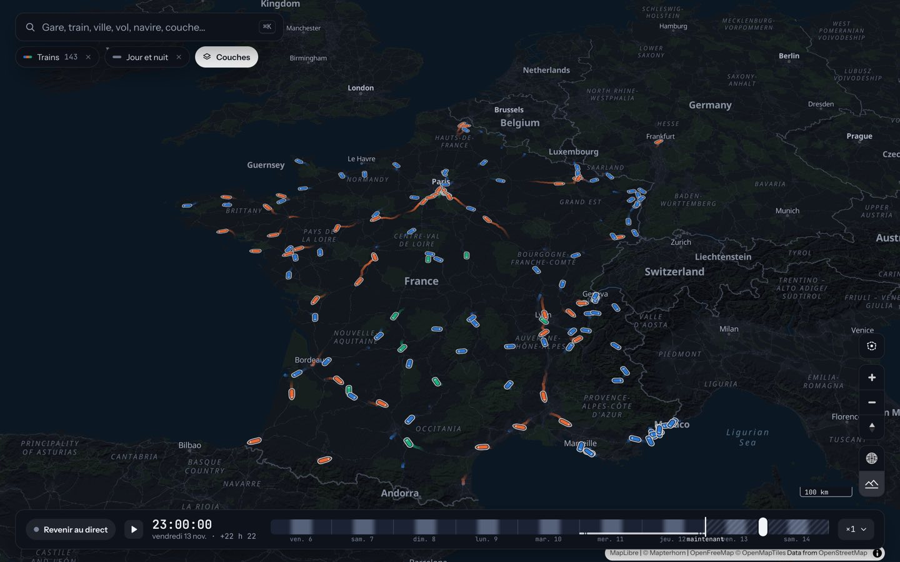
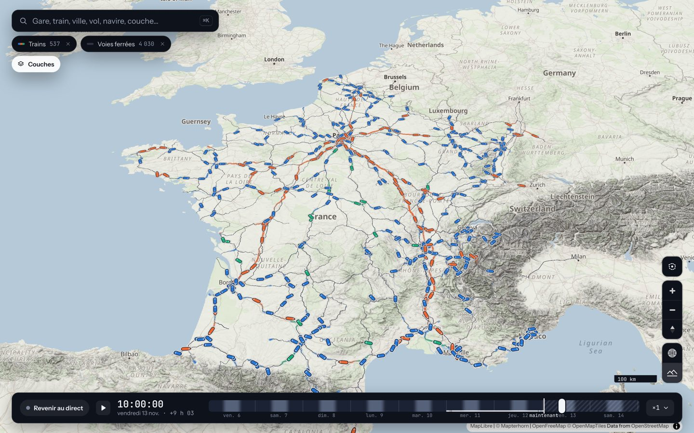
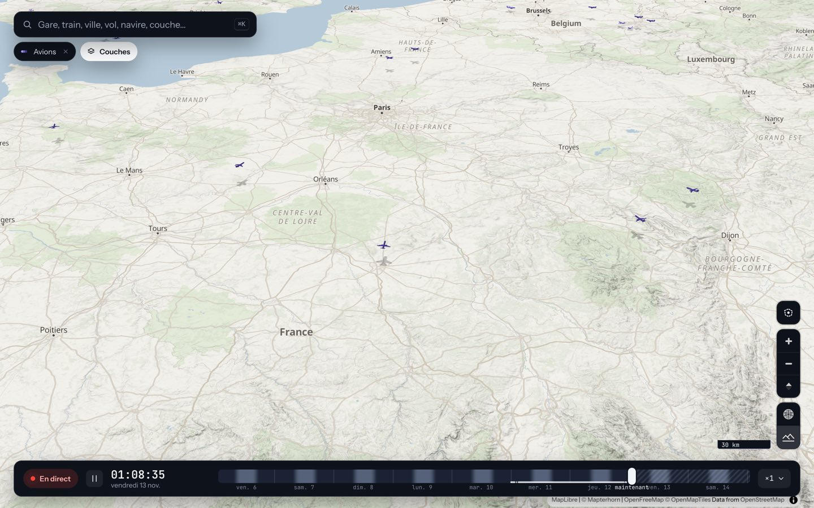
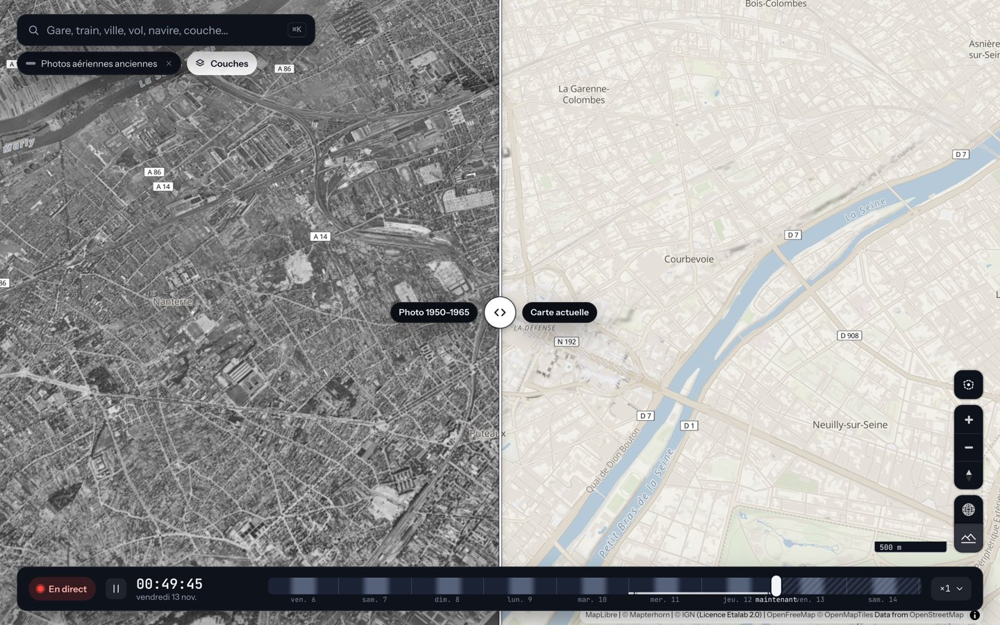
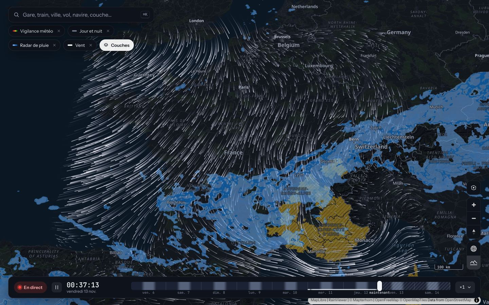

# Les couches

La carte propose **30 couches** (modules de `web/src/modules/`, déclarés dans `modules/index.ts`), rangées en six catégories : Transports, Environnement, Énergie, Territoire, Ciel et espace, Histoire. Ce document donne, pour chacune, ce qu'elle montre et sa source (tableau détaillé), son rythme de rafraîchissement et ses réglages (tableau de référence), puis les notes techniques de quelques couches.

Les couches se combinent : l'adresse de la page garde les couches affichées (`couches=trains,voies`), leurs réglages (`reglages=trains.couleur:retard`) et l'instant (`t=…`). Les identifiants ci-dessous sont ceux de cette adresse. Les licences et attributions de chaque source sont dans [sources-et-licences.md](sources-et-licences.md).

## Tableau de référence

« Site » est le rythme de rechargement des données par le navigateur (`refreshIntervalMs` du module ; « une fois » : pas de rechargement) ; « serveur » est le rythme du collecteur Rust quand la couche passe par lui. Les couches d'une même catégorie sont rangées comme dans le catalogue. Couches affichées par défaut : trains, voies ferrées, séismes, jour et nuit.

| Id | Couche | Catégorie | Site | Serveur | Réglages |
|---|---|---|---|---|---|
| `trains` | Trains | Transports | 60 s | temps réel SNCF toutes les 30 s ; horaires relus si plus vieux que 12 h | Couleur (type ou retard), Rendu (3D ou symboles) |
| `voies` | Voies ferrées | Transports | 2 min | tracés calculés en fond | Couleur |
| `isochrones` | Isochrones | Transports | à la demande | calcul à la requête | Durée maximale, Correspondances, Transports pris en compte, Affichage |
| `trafic` | Trafic routier | Transports | 2 min | événements 2 min ; état 3 min (Rennes 5 min) | Affichage, Événements |
| `avions` | Avions | Transports | 10 s | 10 s | Rendu |
| `bateaux` | Bateaux | Transports | 15 s | publication toutes les 10 s (flux WebSocket continu) | Rendu |
| `transports` | Bus, trams et métros | Transports | 30 s | 30 s (catalogue relu toutes les 6 h) ; Île-de-France : relevé SIRI toutes les 180 s par défaut | Rendu |
| `velos` | Vélos en libre-service | Transports | 60 s | état 60 s, catalogue 6 h | Afficher (vélos ou places) |
| `accidents` | Accidents de la route | Transports | 24 h | fichiers relus tous les 30 jours | Période, Gravité, Vue d'ensemble |
| `vigicrues` | Vigilance crues | Environnement | 30 min | aucun : le navigateur lit Vigicrues | aucun |
| `marees` | Marées | Environnement | 5 min | 10 min | aucun |
| `vigilance-meteo` | Vigilance météo | Environnement | 10 min | 10 min | aucun |
| `air` | Qualité de l'air | Environnement | 30 min | 1 h | aucun |
| `feux` | Feux | Environnement | 30 min | 30 min | aucun |
| `seismes` | Séismes | Environnement | 5 min | aucun : le navigateur lit l'EMSC | aucun |
| `electricite` | Électricité | Énergie | 5 min | aucun : le navigateur lit ODRÉ | aucun |
| `bornes` | Bornes de recharge | Énergie | 6 h | base relue toutes les 24 h | Puissance, Accès |
| `carburants` | Carburants | Énergie | 10 min | aucun : le navigateur lit data.economie.gouv.fr | Carburant |
| `population` | Population | Territoire | une fois | tuiles préparées une fois | Couleur, Affichage |
| `couverture-mobile` | Couverture mobile | Territoire | une fois | tuiles préparées une fois (trimestre 2026 T2) | Technologie, Afficher |
| `immobilier` | Prix de l'immobilier | Territoire | une fois | tuiles refaites chaque semestre | Biens, Période, Référence, Affichage |
| `elections` | Élections | Territoire | 2 min (tant qu'un scrutin se prépare) | tuiles préparées une fois par scrutin | Scrutin, Afficher, Candidat ou liste, Relief |
| `lidar` | Relief LiDAR HD | Territoire | une fois | aucun : le navigateur lit l'IGN | Produit, Opacité, Affichée à partir du zoom |
| `jour-nuit` | Jour et nuit | Ciel et espace | calcul local | aucun | aucun |
| `ombres-batiments` | Ombres des bâtiments | Ciel et espace | calcul local | aucun | aucun |
| `satellites` | Satellites | Ciel et espace | 1 h | éléments orbitaux toutes les 3 h | Starlink |
| `pluie` | Radar de pluie | Ciel et espace | 5 min | aucun : le navigateur lit RainViewer | aucun |
| `vent` | Vent | Ciel et espace | 30 min | 6 h | aucun |
| `photos` | Photos aériennes anciennes | Histoire | calcul local | aucun : le navigateur lit l'IGN | Époque des photos, Comparaison, Opacité |
| `monuments` | Monuments historiques | Histoire | 24 h | base relue chaque semaine | Protection, Genre |

## Galerie

## Ce que montre chaque couche

| Couche | Ce qu'elle montre | Source |
|---|---|---|
| Trains | TGV, Intercités et TER à leur position, sur les vraies voies, avec leurs retards et une vitesse estimée. Couleur par type ou par retard ; de près (zoom 13), chaque rame est une suite de voitures en 3D sur sa vraie longueur, qui suit la voie et sa pente (motrice à nez effilé et voitures à deux niveaux pour le TGV, cabines arrondies pour le TER, locomotive et voitures Corail pour l'Intercités), en fantôme à plat dans les tunnels. Gares de trois tailles selon leur trafic. Trajet et arrêts au clic, tableau d'affichage des gares, caméra qui suit. | SNCF, OpenStreetMap |
| Voies ferrées | Les lignes empruntées par les trains de voyageurs, telles que le serveur les a calculées sur les voies OSM. Trait discret, ou nuances de gris selon la vitesse maximale de la ligne (épaisseur comprise). Fiche au clic : gares du tronçon, longueur, répartition des vitesses, lien vers OpenRailwayMap. | OpenStreetMap |
| Isochrones | Jusqu'où va-t-on en train, en car et en métro depuis une gare, en partant à l'heure de la frise ? Gares et arrêts atteints (cars, métro, RER : plus petits, cernés ambre ou bleu, nommés de près) colorés par heure de trajet, zone lisse autour d'elles (le temps qui reste converti en rayon à 15 km/h, 30 km au plus), gare de départ marquée. Se choisit par l'action « Jusqu'où en train ? » d'une fiche de gare, ou en cherchant « depuis Rennes » ; la gare vit dans l'adresse (`#depuis=87471003`). Réglages : durée maximale, correspondances (aucune à sans limite), transports pris en compte (trains seulement, trains et cars, tous y compris Île-de-France), zone ou gares seules. Fiche d'une gare atteinte : durée, correspondances, itinéraire étape par étape avec pastille de ligne aux couleurs officielles. Une teinte (framboise), une tranche par heure, palette validée sur fond clair et sombre. | SNCF (ODbL) ; Île-de-France Mobilités (ODbL) ; cars interurbains des régions et départements via transport.data.gouv.fr (licences ouvertes de chaque réseau) ; calcul RAPTOR sur le serveur |
| Population | Les habitants au carreau de 200 m : colonnes dont la hauteur est la densité, couleur au choix (densité, niveau de vie moyen, ménages pauvres, 65 ans et plus), ou à plat. Aux zooms bas, des carreaux agrégés (jusqu'à 16 km), ratios recalculés depuis les sommes. Fiche : habitants, niveau de vie, pauvreté, part de valeurs imputées (secret statistique). Tuiles vectorielles préparées par le serveur. | INSEE, Filosofi 2019, données carroyées (licence ouverte Etalab 2.0) |
| Couverture mobile | Couverture 4G et voix (2G/3G) des quatre opérateurs au carreau de 250 m, à plat : nombre d'opérateurs (zones blanches en évidence) ou qualité d'un opérateur. Polygones de l'ARCEP rastérisés par le serveur, agrégés aux zooms bas. Fiche : niveau par opérateur, date des cartes, simulations et non mesures. | ARCEP, Mon réseau mobile (Licence Ouverte) |
| Avions | Les avions au-dessus de la France et autour, en direct, à leur altitude réelle (couleur selon l'altitude), avec leur indicatif. Sept maquettes 3D selon le type d'appareil (biréacteur, gros-porteur, quadriréacteur, turbopropulseur, jet d'affaires, avion léger, hélicoptère), cabrées en montée, inclinées en virage, avec leur ombre au sol, à l'envergure réelle de près (silhouettes à plat de loin) ; anneau rouge pour une urgence déclarée (squawk 7500, 7600, 7700). Fiche au clic, caméra qui suit. En direct seulement. | [adsb.lol](https://adsb.lol) |
| Bateaux | Les navires autour de la France et sur les fleuves, d'après leurs émissions AIS : couleur par famille (marchandises, passagers, pêche et plaisance), maquettes 3D selon le type AIS (porte-conteneurs avec ses conteneurs, pétrolier, ferry, paquebot, pêche, voilier, plaisance, remorqueur…) aux dimensions AIS, ligne de flottaison comprise, sillage proportionnel à la vitesse, taille réelle de près, noms en étiquettes de carte sans chevauchement. Fiche au clic (destination, dimensions…), caméra qui suit. En direct seulement ; demande une clé aisstream.io sur le serveur. | [aisstream.io](https://aisstream.io) |
| Bus, trams et métros | Les véhicules des transports urbains en direct, dans les ~140 réseaux français qui publient leurs positions (GTFS-RT, relues toutes les 30 s). Couleur et numéro de la ligne quand le réseau les donne ; maquettes 3D de bus, bus articulé, tram et métro orientées selon le cap (silhouettes à plat sous le zoom 15) ; une position estimée d'après les horaires (47 réseaux) est translucide, sur une empreinte en pointillé. De loin, un rond par réseau ; de près, chaque véhicule, qui glisse d'une position à la suivante. Fiche au clic. En direct seulement. **Île-de-France** (avec une clé PRIM, `IDFM_PRIM_API_KEY`) : métro, RER, Transilien, tramways et câble, aux couleurs officielles des lignes (GTFS d'Île-de-France Mobilités). IDFM ne publie pas de positions : les prochains passages de sa requête globale SIRI (un relevé toutes les 180 s, soit 480 des 1 000 requêtes quotidiennes du quota) sont rapprochés des courses du GTFS (par identifiant pour les trains SNCF, par arrêts et heures pour le métro et les tramways) et placent chaque rame sur son tracé ; le retard est affiché quand le SIRI donne aussi l'horaire théorique (RER, Transilien). Les RER et Transilien ont la maquette de rame du métro. Tous sont translucides (positions estimées), le métro sous terre aussi. Les bus (≈ 160 000 courses, +80 Mo en permanence, +175 Mo de pic à chaque relecture du GTFS : voir [Bus d'Île-de-France](couches.md#bus-dîle-de-france--mesures-et-recommandation)) sont facultatifs et désactivés par défaut : `IDFM_MODES=metro,tram,train,cable,bus`. | réseaux de transport via [transport.data.gouv.fr](https://transport.data.gouv.fr) (Licence Ouverte 2.0 ou ODbL) ; Île-de-France : [Île-de-France Mobilités / PRIM](https://prim.iledefrance-mobilites.fr) (ODbL) |
| Vélos en libre-service | Les 5 800 stations des 84 réseaux de France (Vélib', Vélo'v, VélôToulouse…), relues chaque minute. Mode « Vélos » pour en trouver un, « Places » pour le rendre ; vu de près, une jauge en anneau donne la part de vélos disponibles, avec le nombre. Une station hors service est un simple anneau gris. | réseaux GBFS via [transport.data.gouv.fr](https://transport.data.gouv.fr) |
| Vigilance crues | Niveau de vigilance des 337 tronçons de rivières surveillés, de vert à rouge (épaisseur du trait selon le niveau). Couche MapLibre drapée sur le relief. | [Vigicrues](https://www.vigicrues.gouv.fr) |
| Marées | Le niveau de la mer aux 83 marégraphes de la côte métropolitaine, en direct : un cercle qui se remplit comme une jauge (plein à la pleine mer, vide à la basse mer, d'après les 48 dernières heures du port), une pointe vers le haut ou le bas selon que la mer monte ou descend, le niveau en mètres au-dessus du zéro hydrographique. Fiche : courbe des 48 h, dernières pleines et basses mers mesurées, prochaines estimées (24 ports). Suit l'horloge : en rejouant, la jauge suit la courbe mesurée puis l'estimation. | [Shom, REFMAR](https://refmar.shom.fr) via data.shom.fr (Licence Ouverte 2.0) |
| Bornes de recharge | Les 45 000 stations de recharge pour véhicules électriques, colorées selon leur puissance maximale (quatre classes de turquoise) ; pictogramme de prise et puissance écrite de près. Réglages : puissance (toutes, rapides, ultra-rapides) et accès. Fiche : opérateur, prises, tarif, horaires. Pas de disponibilité en temps réel. | Base nationale des IRVE, [transport.data.gouv.fr](https://transport.data.gouv.fr) (Licence Ouverte 2.0) |
| Trafic routier | Événements du réseau routier national non concédé (bouchons, accidents, fermetures, travaux, dangers ; un pictogramme par famille) et état de la circulation (fluide à coupé) autour des grandes villes. Réglage Événements / État / Les deux. Les autoroutes concédées ne sont pas couvertes. | Bison Futé via transport.data.gouv.fr (Licence Ouverte 2.0), Rennes Métropole (ODbL) |
| Vigilance météo | Niveau de vigilance de chaque département, aujourd'hui et demain (suit l'horloge), doublé d'une trame et d'un contour. Fiche : phénomènes et créneaux. | Météo-France via data.gouv.fr (Licence Ouverte 2.0), contours IGN Admin Express |
| Qualité de l'air | Indice ATMO de près de 29 000 communes ou intercommunalités de métropole (palette officielle, du bon à l'extrêmement mauvais), pour le jour de l'horloge : aujourd'hui, demain, parfois après-demain (l'indice n'a pas d'historique). De loin un champ de couleur continu, de près des pastilles. Fiche : niveau, polluant dominant, cinq sous-indices, association régionale, épisodes de pollution du département. Demande `ATMO_USERNAME` et `ATMO_PASSWORD` côté serveur ; sans eux, la couche est désactivée. | Atmo France / AASQA via [Atmo Data](https://admindata.atmo-france.org) (données ouvertes) |
| Feux | Points chauds détectés par satellite sur 7 jours (incendies, brûlages agricoles, sites industriels). La couleur dit l'âge à l'instant affiché, la taille la puissance du feu : on les voit apparaître en rejouant la semaine. | [NASA FIRMS](https://firms.modaps.eosdis.nasa.gov) (VIIRS) |
| Séismes | Les 7 derniers jours : tous autour de la France, magnitude 4,5 et plus dans le monde. Ceux de moins de 3 h pulsent. | [EMSC](https://www.seismicportal.eu) |
| Électricité | Sur chaque région, une colonne 3D empile la production par filière, et un anneau blanc marque la consommation. Au quart d'heure, et suit la frise temporelle. | RTE éCO2mix via [ODRÉ](https://odre.opendatasoft.com) |
| Carburants | Prix actuels dans les 9 800 stations-service, colorés par rapport au reste de la France (bleu moins cher, rouge plus cher), au choix du carburant. Vu de près, une étiquette de prix ; la moins chère l'emporte quand deux étiquettes se gêneraient. | [prix-carburants.gouv.fr](https://www.prix-carburants.gouv.fr) |
| Prix de l'immobilier | Prix de vente au m² des logements (DVF 2021-2025) : médiane par carreau (32 km à 100 m selon le zoom, histogrammes fusionnés), ventes une à une de près ; biens, période (12 mois / 5 ans), relief. Fiche : médiane, quartiles, nombre de ventes, lien vers l'explorateur officiel. | DGFiP, DVF ; Etalab (licence ouverte 2.0) |
| Élections | Résultats par bureau de vote, commune et département : présidentielle 2022 (deux tours), européennes 2024, législatives 2024 (deux tours), municipales 2026 (deux tours : nuance de la liste en tête, grise sans nuance ; fiche avec les listes de la commune). Participation, nuance en tête ou part d'un candidat, à plat ou en relief ; fiche avec chaque nuance ou liste. Tuiles vectorielles, une archive par scrutin. | Ministère de l'Intérieur ; Etalab (contours des bureaux de vote) ; IGN |
| Satellites | Stations spatiales (ISS, Tiangong), satellites de navigation, météo et les plus brillants, en silhouettes neutres, à leur position calculée pour l'instant affiché (replay compris) ; Starlink en option. Altitude figurée par une tige (échelle non respectée), trace au sol de l'orbite au clic, visibilité de l'ISS depuis le centre de la carte. | [CelesTrak](https://celestrak.org) |
| Jour et nuit | Le fond de carte passe à sa palette sombre la nuit (soleil au centre de la vue), l'ombre de la nuit et des crépuscules se voit de loin. Les bâtiments 3D sont éclairés depuis la vraie position du soleil. | calcul astronomique |
| Radar de pluie | Les précipitations mesurées par radar, des deux dernières heures, drapées sur le relief. | [RainViewer](https://www.rainviewer.com) |
| Relief LiDAR HD | Le relief et la hauteur du sursol d'après le LiDAR HD de l'IGN, en raster sous les étiquettes, à partir du zoom 14 (réglable) : estompage du terrain nu (MNT), de la surface (MNS) ou de la hauteur (MNH), ou hauteur de la végétation et du bâti en couleurs (vert au sol, jaune, orange, rouge). Produit, opacité et zoom réglables ; drapé sur le relief. Couverture partielle. | [IGN, Géoplateforme](https://geoservices.ign.fr/lidarhd) (Licence Etalab 2.0), mention « IGN, LiDAR HD » |
| Photos aériennes anciennes | Les orthophotographies de l'IGN, des années 1950 (couche principale, 1950–1965) à aujourd'hui (1965–1980, 1980–1995, 2000–2005, 2006–2010, 2011–2015, actuelle), avec un **rideau avant / après** : une poignée verticale que l'on glisse (souris, doigt ou clavier) ; à gauche la photo, à droite la carte d'aujourd'hui. Réglage « Transparence » (curseur d'opacité) à la place du rideau. Drapée sur le relief 3D, étiquettes et couches par-dessus. Fiche : époque, ce que l'on voit, lien « Remonter le temps ». Indisponible sur le globe. | IGN, Géoplateforme (WMTS, sans clé), Licence Etalab 2.0 |
| Monuments historiques | Les 44 500 immeubles protégés de la base Mérimée. Le **pictogramme** dit le genre (religieux, château et demeure, militaire, civil et urbain, archéologique, industriel et ouvrage d'art, funéraire et commémoratif), la **forme du badge** dit la protection : carré sombre pour un monument classé, rond clair pour un inscrit (aucune couleur : le noir et blanc ressort de jour comme de nuit). Points de loin, pictogrammes dès le zoom 11, noms dès le 14 (désencombrés, les classés d'abord). Réglages : protection, genre. Fiche : nom, commune, protection et date, époque, description quand la base en a une, lien vers la notice POP. | Base Mérimée, ministère de la Culture, via [data.gouv.fr](https://www.data.gouv.fr/datasets/immeubles-proteges-au-titre-des-monuments-historiques-2) (Licence Ouverte 2.0) |
| Accidents de la route | Les ~270 000 accidents corporels des cinq dernières années (métropole). De loin : une grille de cases, **hauteur** = nombre d'accidents (colonnes 3D, ou « Aplat »), **teinte** = part des accidents ayant fait un tué ou un hospitalisé. À partir du zoom 12,5 : un point par accident, coloré par la **pire issue** parmi les personnes impliquées (indemne, blessé léger, blessé hospitalisé, tué ; une seule teinte ocre-brun du clair au foncé, taille et liseré en plus). Réglages : période (5, 3 ou 1 an), gravité (tous, avec hospitalisés ou tués, mortels). Fiche : date et heure, luminosité, météo, route, décomptes de personnes par gravité, véhicules impliqués. **Aucune donnée individuelle** : ni âge ni sexe, jamais lus par le serveur. | ONISR, [data.gouv.fr](https://www.data.gouv.fr/datasets/bases-de-donnees-annuelles-des-accidents-corporels-de-la-circulation-routiere-annees-de-2005-a-2024/) (Licence Ouverte) |
| Vent | Le vent à 10 m, animé en traînées, d'après la prévision ARPEGE (suit l'horloge). | Météo-France ARPEGE via [Open-Meteo](https://open-meteo.com) |
| Ombres des bâtiments | L'ombre portée de chaque bâtiment selon la position du soleil, à partir du zoom 14. | calcul astronomique, bâtiments OpenStreetMap |

Les couleurs des trains ont été vérifiées pour le daltonisme. Trois familles (TER, grande vitesse, Intercités) reprennent les trois premières couleurs de la palette de référence. Le mode « retard » utilise une seule teinte, de plus en plus sombre, car le vert et le rouge sont confondus par les daltoniens.

## Notes techniques

### Trains : comment ils sont placés

1. Le serveur charge les horaires théoriques (52 000 trajets) et interroge le temps réel SNCF toutes les 30 secondes.
2. Pour chaque paire de gares consécutives, il cherche le chemin sur les voies OSM : c'est un plus court chemin sur un graphe d'environ un million de points (A*). Il attribue ensuite à chaque point l'altitude du relief. Sur les ponts et dans les tunnels, une pente régulière remplace le sol, qui n'y est pas à la hauteur du rail.
3. Le site télécharge une fois le **réseau** (toutes les gares et tous les tracés, 1,7 Mo compressés), publié sous une version qui est l'empreinte de son contenu : le navigateur le garde en cache, même d'une visite à l'autre. Puis il demande chaque minute les trains de quelques heures autour de l'instant affiché (environ 170 Ko compressés à l'heure de pointe, contre 1,5 Mo quand les tracés étaient renvoyés à chaque fois). Pour chaque tronçon entre deux gares, il calcule un **profil de vitesse** : le train accélère au départ, roule à la vitesse permise de la voie (balise OSM `maxspeed`, connue pour 96 % des points), sans dépasser celle de son matériel (320 km/h en grande vitesse, 200 en Intercités, 160 en TER), puis freine avant la gare. Ce profil « au plus vite » est ensuite étiré pour tomber pile sur l'horaire, réel ou prévu, car les horaires comportent toujours une marge.
4. À chaque image, le site place chaque train le long de son tracé selon ce profil, et le dessine dans son sens de marche. Seule la portion des chemins proche de l'instant affiché est envoyée à la carte graphique pour les traînées (dix fois moins de sommets) : le rafraîchissement du temps réel ne fige plus l'animation.
5. Si un tronçon n'a pas de tracé (voie absente d'OSM, gare trop loin d'une voie), le train y va en ligne droite. La fiche du train l'indique.

La vitesse affichée est donc une **estimation**. La SNCF ne publie pas la position GPS de ses trains en open data.

**Clic sur un train** : tout son trajet est surligné, avec la partie déjà faite en gris. Sa fiche liste les arrêts avec leurs horaires et retards, et donne la vitesse estimée et la vitesse autorisée de la ligne. Le bouton « Suivre » fait suivre le train par la caméra ; déplacer la carte arrête le suivi.

**Clic sur une gare** (visibles à partir du zoom 8,5) : son tableau des départs et des arrivées, trains supprimés compris. Chaque ligne d'un tableau mène au train ou à la gare correspondante.

### Photos aériennes : le rideau avant / après

MapLibre ne sait pas découper une couche à l'écran, et avec le relief 3D ses couches raster sont dessinées dans des textures par tuile, puis plaquées sur le terrain : un masque d'écran n'y change rien. Le module (`web/src/modules/aerialCurtain.ts`) dessine donc lui-même les tuiles de l'IGN dans une **couche WebGL « custom »** : chaque tuile est un maillage de 8 × 8 cases dont les sommets prennent l'altitude affichée du relief (`queryTerrainElevation`), et un `discard` dans le shader sur `gl_FragCoord.x` fait le rideau. La couche s'intercale sous les étiquettes : noms de lieux et couches deck.gl restent par-dessus la photo. Une deuxième carte synchronisée aurait coûté un second rendu du relief et caché ces couches du côté photo. Limites : les bâtiments 3D d'aujourd'hui dépassent de la photo quand la carte est inclinée ; indisponible sur le globe.

### Accidents de la route : lecture des données

`server/src/accidents.rs` retrouve dans le catalogue de data.gouv.fr les quatre fichiers des cinq dernières années complètes (leurs noms changent d'une année à l'autre, et la clé de 2022 s'appelle `Accident_Id`), les télécharge un par un, les joint sur `Num_Acc` et ne garde que 24 octets par accident, servis **en colonnes** et compressés en gzip (`/api/accidents`, 5 Mo environ). Seuls des *décomptes* de personnes par gravité sont lus (colonnes `grav` et `catu`) ; l'âge et le sexe ne sont jamais chargés. Le cache vit dans `DATA_DIR/accidents/` ; le catalogue est relu chaque mois.

### Marées (marégraphes REFMAR)

Le serveur (`server/src/tides.rs`) relève toutes les 10 minutes les 83 marégraphes de la côte métropolitaine et publie `/api/marees` (~160 Ko avant compression).

- **Source et licence.** Le Shom diffuse les observations de son réseau (RONIM) et de ses partenaires sur data.shom.fr, en JSON, sans clé (`…/maregraphie/observation/json/<id>?sources=1&dtStart=…&dtEnd=…`, SOS 52°North derrière). Licence Ouverte 2.0 (jeux de données « Marégraphes RONIM » et « Marégraphes partenaires » sur data.gouv.fr). Mention « Shom, REFMAR ». Sources utilisées : `1` (brut haute fréquence, une mesure par minute, quelques minutes de retard) et `2` (brut temps différé, 10 minutes, jusqu'à la veille). Ces mesures sont **brutes, ni validées ni expertisées** ; les hauteurs sont au-dessus du zéro hydrographique, propre à chaque port.
- **Les marées prévues ne sont pas ouvertes.** Les prédictions officielles du Shom (annuaire des marées, maree.shom.fr) ne sont pas en données ouvertes : on ne s'en sert pas. À la place, **une estimation** : pour les ports dont la marée est nette (composante M2 d'au moins 0,25 m) et qui ont assez de mesures différées, on ajuste sur les 29 derniers jours sept composantes harmoniques (M2, S2, N2, K1, O1, M4, MS4, moindres carrés) et on prolonge de 36 h. Essai à l'aveugle (ajustement sur 29 jours se terminant 2 jours avant, comparé aux 2 jours suivants) : heures des pleines et basses mers à 7–15 minutes près à Brest, Saint-Malo et Dieppe, hauteurs à 0,25–0,35 m près ; la météo (surcote, dépression) n'est pas prévue. 24 ports sur 83 ont une estimation (les autres n'ont pas assez de mesures différées) ; la Méditerranée n'en a pas (marée de quelques centimètres). La fiche dit « estimée » partout.
- **Liste des stations.** `server/src/tides_stations.json` : identifiant, nom, position (les positions viennent du GetCapabilities SOS, les noms de refmar.shom.fr). Elle a été établie en gardant les stations métropolitaines dont les mesures arrivaient en continu, un seul marégraphe par site (3 km). Une station muette plus de 12 h disparaît de la carte jusqu'à son retour. Pour la refaire : relire le GetCapabilities (`/maregraphie/sos/service?request=GetCapabilities&service=SOS`) et la liste de refmar.shom.fr/observatoires-maregraphiques.
- **Mémoire.** 48 h en médianes de 10 minutes par station et les constantes harmoniques : moins d'un mégaoctet. Au démarrage, 83 requêtes de 48 h puis 83 de 29 jours (environ 30 Mo téléchargés), ensuite 83 petites requêtes toutes les 10 minutes, 4 à la fois.

### Relief LiDAR HD

Tout se passe dans le navigateur (`web/src/modules/lidar.ts`) : une couche raster MapLibre insérée sous les étiquettes (et sous l'ombre de la nuit), donc lisible avec le relief 3D comme sans.

- **Produits.** Les trois estompages du LiDAR HD (MNT = terrain nu, MNS = surface avec arbres et toits, MNH = hauteur du sursol) sont des tuiles WMTS prêtes. La hauteur *en couleurs* n'existe qu'en WMS (style `hypso_mnh`) : la carte demande des images de 256 px en EPSG:3857. L'IGN ne publie pas la valeur de chaque teinte (la légende renvoie « aucune légende »), la légende de la couche reste qualitative.
- **Couverture.** Partielle et croissante : là où le LiDAR HD n'est pas encore publié, le WMTS répond 404 (la carte du dessous reste visible ; la console du navigateur le note). Vérifié en novembre 2026 : Paris, Brest, Lyon, Marseille, Chamonix couverts ; Creuse (46 N, 2 E) non. La couche ne s'affiche qu'à partir du zoom 14 par défaut (réglable de 11 à 17).
- **Un modèle d'altitude LiDAR pour remplacer le relief ?** Pas tel quel. La Géoplateforme sert l'altitude en dalles flottantes `image/x-bil;bits=32` (couches `ELEVATION.ELEVATIONGRIDCOVERAGE.HIGHRES` : RGE Alti, zoom 6 à 14, et `….HIGHRES.MNS`, zoom 4 à 17, sur la grille WGS84G), pas en tuiles « terrain-RGB » que MapLibre sait lire (`raster-dem` attend Mapbox ou Terrarium). Il faudrait un convertisseur côté serveur (relire le BIL, encoder en PNG Terrarium, mettre en cache) et mesurer l'effet sur la mémoire GPU et le temps de chargement. Le relief n'a donc pas été touché : l'estompage drapé sur le relief Mapterhorn actuel donne déjà le détail visuel.

### Bus d'Île-de-France : mesures et recommandation

Les bus (`IDFM_MODES=metro,tram,train,cable,bus`) restent **facultatifs et désactivés par défaut**. Mesures du 12 novembre 2026, sur le vrai GTFS d'IDFM (zip de 114 Mo), en version release, un processus par mesure (`idf/measure.rs`, test ignoré : `IDFM_ZIP=… IDFM_MODES=… ./binaire-de-test mesure_gtfs_idfm --ignored --nocapture`, voir l'en-tête du fichier ; la clé PRIM n'est pas nécessaire).

| | sans bus | avec bus, avant | avec bus, après |
|---|---|---|---|
| courses gardées (hier, aujourd'hui, demain) | 40 351 | 178 994 | 158 891 |
| motifs / arrêts / points de tracé | 716 / 1 839 / 74 000 | 8 508 / 35 230 / 948 000 | 8 467 / 35 209 / 945 000 |
| modèle compact (`approx_bytes`) | 7,9 Mo | 45,5 Mo | 42,0 Mo |
| mémoire résidente après la construction | 54 Mo | 196 Mo | **136 Mo** |
| pic de la construction | 57 Mo | non mesuré | **230 Mo** |

Ce qui a été fait pour la mémoire : (1) les bus ne gardent pas « demain » (`Config::service_days`, `gtfs_compact::build_days`) : 20 000 courses de moins (les bus de demain sont presque les mêmes que ceux d'aujourd'hui : 144 725 courses roulent aujourd'hui, 145 832 demain) ; une course qui ne roule que demain n'est lue qu'au changement de jour, où le GTFS est relu. (2) La construction ne garde plus une copie des heures de chaque course (des millions de paires). (3) Les index par identifiant sont libérés avant le gros du travail. Le gros du poids est ailleurs et ne se réduit pas sans réécrire la lecture (`stop_times.txt` entier en mémoire : 3,4 millions de lignes de bus ×20 octets, puis les tracés) : une lecture en flux, course par course, réduirait le pic d'une centaine de Mo.

**Rapprochement** (mesuré sans clé : on fabrique, d'après le GTFS, ce que le SIRI annoncerait pour les 119 360 bus en circulation à 8 h 30, avec 6 arrêts chacun et un retard de −1 à +5 minutes, **en cachant l'identifiant de la course**, puis on vérifie que `match_journeys` retrouve la course) : avec l'heure théorique donnée par le SIRI, 100 % de bonnes attributions, aucune mauvaise ; sans elle, 84,6 % de bonnes, 3 mauvaises sur 119 360, et 15,4 % sans course (retard de plus de 4 minutes, le seuil). Tests unitaires avec un SIRI écrit à la main (`idf/tests.rs`) : des bus à dix minutes d'écart, dont un avec 6 minutes de retard qui est à l'heure du suivant, sont chacun attribués à leur course d'après l'heure *théorique* ; sans heure théorique un retard d'une minute est bien attribué ; une course qui ne roule que demain n'est pas gardée. Une attribution prend ~0,9 s pour tous les bus. **Non mesuré** : la qualité sur de vraies réponses PRIM (il faut la clé) : le taux réel dépendra de la part des bus pour lesquels le SIRI donne l'heure théorique et des arrêts que le GTFS ne connaît pas.

**Recommandation : ne pas activer les bus en production avec la limite de 1 Go.** Au repos (~640 Mo), il faut compter +80 Mo en permanence (136 − 54 Mo résidents) ; à chaque relecture du GTFS (au démarrage et à chaque changement de jour, l'ancien modèle étant gardé pendant la construction du nouveau) un pic de +175 Mo ; et à chaque relevé du SIRI (toutes les 180 s) les circulations des bus ajoutent de l'ordre de +100 à +200 Mo transitoires (mesuré avec 119 000 circulations de 6 arrêts). Les pics de 710 Mo des fabrications de tuiles, additionnés à l'un de ces transitoires, dépassent 900 Mo : le risque d'être tué par le plafond est réel. Les bus deviennent raisonnables avec une limite de 1,5 Go (`mem_limit` dans `compose.yaml`), ou après une lecture du GTFS en flux et un SIRI traité circulation par circulation (sans tout garder) ; ils ne rendraient alors pas la couche plus lourde à l'écran, qui montre déjà des milliers de véhicules.
