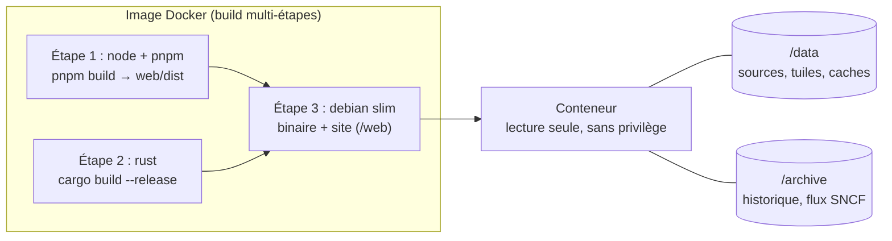

# Déploiement

Le serveur tourne en permanence dans Docker (`compose.yaml`, `server/Dockerfile`) : il archive le temps réel en continu, enregistre l'historique des couches mobiles et sert le site. Rien n'est exposé à Internet par défaut.



L'image se construit depuis la racine du dépôt (contexte `.`). Étapes du `server/Dockerfile` : Node 24 et pnpm 12.8.1 construisent le site, Rust 1.94 compile le serveur (les dépendances d'abord, pour garder le cache Docker), puis une image Debian `trixie-slim` avec les certificats ne contient que le binaire et le site. Le conteneur ne tourne jamais en administrateur.

## Installation

```bash
git clone https://github.com/LM28000/openstreetmap.git carte-vivante && cd carte-vivante
mkdir -p data archive              # avant le premier démarrage : sinon Docker les crée au nom de root
cat > .env <<EOF
BIND_ADDRESS=192.168.0.75          # adresse d'écoute (127.0.0.1 par défaut : la machine seule)
RUN_AS=1000:1000                   # utilisateur:groupe propriétaire de data/ et archive/
ARCHIVE_PATH=./archive             # où garder les archives (environ 50 Mo par jour)
EOF
# Facultatif, couche « Bateaux » : clé gratuite d'aisstream.io, saisie sans l'afficher.
read -rsp "Clé aisstream : " k && printf 'AISSTREAM_API_KEY=%s\n' "$k" >> .env && chmod 600 .env && unset k
# Facultatif, couche « Qualité de l'air » : compte gratuit Atmo Data (admindata.atmo-france.org).
# Le conteneur doit recevoir ATMO_USERNAME et ATMO_PASSWORD (comme AISSTREAM_API_KEY) ; entre apostrophes.
read -rp "Identifiant Atmo Data : " u && printf "ATMO_USERNAME='%s'\n" "$u" >> .env
read -rsp "Mot de passe Atmo Data : " p && printf "ATMO_PASSWORD='%s'\n" "$p" >> .env && chmod 600 .env && unset u p
# Facultatif, métro, RER, Transilien et tramways d'Île-de-France : clé gratuite de la plateforme PRIM
# (prim.iledefrance-mobilites.fr, quota de 1 000 requêtes par jour, dont la carte n'en prend que 480).
read -rsp "Clé PRIM : " k && printf "IDFM_PRIM_API_KEY='%s'\n" "$k" >> .env && chmod 600 .env && unset k
docker compose up -d --build       # installer, ou mettre à jour après un git pull
docker compose logs -f             # suivre les journaux
```

Le conteneur est isolé : son système de fichiers est en lecture seule, il n'a aucun privilège, sa mémoire est limitée à 1 Go (le pic mesuré est de 540 Mo) et ses journaux sont bornés à 30 Mo. Il n'écoute que sur l'adresse choisie et n'est pas exposé à Internet.

Les archives sont rangées dans `archive/sncf-trip-updates/AAAA-MM-JJ/HHMMSS.pb.gz` (heure UTC), une par version du flux temps réel.

Le fichier `.env` n'est jamais versionné (voir [SECURITY.md](../.github/SECURITY.md)). Le modèle des variables est dans [`.env.example`](../.env.example).

## Variables d'environnement

Toutes les variables lues par le serveur (`grep -rn 'env::var' server/src`), avec leur valeur par défaut. Une variable vide ou absente prend la valeur par défaut. Aucune clé n'est jamais renvoyée au navigateur.

### Serveur

| Variable | Défaut | Rôle |
|---|---|---|
| `HOST` | `127.0.0.1` (`0.0.0.0` dans l'image) | Adresse d'écoute. |
| `PORT` | `8787` | Port d'écoute. |
| `DATA_DIR` | `../data` (`/data` dans l'image) | Où ranger les fichiers téléchargés, les tuiles et les caches. |
| `ARCHIVE_DIR` | aucun (`/archive` dans l'image) | S'il est défini : archive le flux temps réel SNCF et enregistre l'historique des avions, bateaux et transports. |
| `WEB_DIR` | `../web/dist` (`/web` dans l'image) | Site construit à servir à la racine ; ignoré si le dossier ne contient pas `index.html` (l'API seule est alors servie). |
| `RUST_LOG` | `info,tower_http=warn` | Niveau des journaux (syntaxe `tracing`). |
| `HISTORIQUE_JOURS` | `7` | Jours d'historique conservés (de 1 à 365 ; une autre valeur redonne 7). |
| `ARCHIVE_SNCF_JOURS` | `180` | Jours de conservation de l'archive brute du flux SNCF ; `0` = sans limite. |

### Couches qui demandent un compte ou une clé

| Variable | Défaut | Rôle |
|---|---|---|
| `AISSTREAM_API_KEY` | aucune | Clé [aisstream.io](https://aisstream.io) ; sans elle, la couche « Bateaux » est désactivée. |
| `ATMO_USERNAME`, `ATMO_PASSWORD` | aucun | Compte Atmo Data ; sans eux, la couche « Qualité de l'air » est désactivée. |
| `IDFM_PRIM_API_KEY` | aucune | Clé PRIM d'Île-de-France Mobilités ; sans elle, métro, RER, Transilien et tramways d'Île-de-France sont ignorés. |

### Île-de-France (PRIM)

| Variable | Défaut | Rôle |
|---|---|---|
| `IDFM_MODES` | `metro,tram,train,cable` | Modes suivis ; ajouter `bus` demande +80 Mo en permanence et +175 Mo de pic (voir [couches](couches.md#bus-dîle-de-france--mesures-et-recommandation)). |
| `IDFM_INTERVALLE_S` | `180` (minimum `120`) | Intervalle du relevé SIRI, en secondes. |
| `IDFM_MEMOIRE_MO` | `100` | Budget de mémoire du modèle d'Île-de-France. |
| `IDFM_GTFS_URL` | GTFS public d'Île-de-France Mobilités | Adresse du GTFS (doit commencer par `https://`). |

### Transports estimés

| Variable | Défaut | Rôle |
|---|---|---|
| `TRANSPORTS_ESTIMES` | actif | `non` désactive les positions estimées d'après les horaires. |
| `TRANSPORTS_DECALAGE_S` | `0` | Décale l'horloge (test hors du direct ; le temps réel est alors ignoré). |

### Isochrones

| Variable | Défaut | Rôle |
|---|---|---|
| `ISO_CARS_TER` | actif | `non` : ignore les Car TER du GTFS SNCF. |
| `ISO_IDF` | actif | `non` : ignore le métro, RER, Transilien et tramways d'Île-de-France. |
| `ISO_CARS_REGIONAUX` | actif | `non` : ignore les cars interurbains régionaux. |
| `ISO_CACHE_MO` | `800` | Taille maximale du cache des GTFS régionaux (`transit-interurbain/`). |
| `ISO_MEMOIRE_MO` | `80` | Budget de mémoire des cars régionaux. |

### Moteur de tuiles

| Variable | Défaut | Rôle |
|---|---|---|
| `TUILES_JEUX` | tous | Liste, séparée par des virgules, des jeux à mettre en service (`population`, `couverture`, `dvf`, `elec-p22t1`…). |
| `TUILES_EFFACER_SOURCES` | non défini | Si défini (n'importe quelle valeur) : efface la source d'un jeu après sa fabrication. |
| `INSEE_CARREAUX_URL` | millésime 2019 de l'INSEE | Adresse du zip des carreaux de population. |
| `ARCEP_OPERATEURS` | tous (`OF,SFR0,BOUY,FREE`) | Restreint les opérateurs (essai réduit ; entre dans l'identifiant de la source). |
| `ARCEP_TECHNOS` | `4g,voix` | Restreint les technologies. |
| `ARCEP_DEPARTEMENTS` | tous | Restreint les départements, ex. `29,22`. |
| `ARCEP_GARDER_SOURCES` | non défini | Si défini : garde les archives 7z de l'ARCEP. |

### Réservées aux tests et mesures (inutiles en production)

`ACCIDENTS_DIR`, `MONUMENTS_CSV`, `IDFM_ZIP`, `IDFM_TOUS_LES_JOURS`, `IDFM_SANS_RAPPROCHEMENT` : lues uniquement par des tests ignorés qui mesurent la mémoire sur de vrais fichiers (voir leurs commentaires dans `server/src/accidents.rs`, `monuments.rs` et `idf/measure.rs`).

### Posées par l'image Docker

`HOST`, `PORT`, `DATA_DIR`, `ARCHIVE_DIR`, `WEB_DIR` et `RUST_LOG` (valeurs ci-dessus), et `MALLOC_ARENA_MAX=2` : la glibc garde une réserve de mémoire par fil d'exécution ; avec tokio et les gros fichiers lus au démarrage, elle gonflait l'empreinte sans la rendre.

### Lues par `compose.yaml` (côté hôte)

| Variable | Défaut | Rôle |
|---|---|---|
| `BIND_ADDRESS` | `127.0.0.1` | Adresse de la machine sur laquelle le port est publié. |
| `PORT` | `8787` | Port publié. |
| `RUN_AS` | `1000:1000` | Utilisateur:groupe du conteneur (propriétaire de `data/` et `archive/`). |
| `DATA_PATH` | `./data` | Dossier monté sur `/data`. |
| `ARCHIVE_PATH` | `./archive` | Dossier monté sur `/archive`. |

`compose.yaml` transmet au conteneur `AISSTREAM_API_KEY`, `ATMO_USERNAME`, `ATMO_PASSWORD`, `IDFM_PRIM_API_KEY`, `IDFM_MODES`, `IDFM_INTERVALLE_S` et `IDFM_MEMOIRE_MO`. Les autres réglages du serveur (`TUILES_*`, `ISO_*`, `HISTORIQUE_JOURS`…) n'y sont pas déclarés : pour les changer dans Docker, il faut les ajouter à la section `environment` de `compose.yaml`.

### Côté site (développement seulement)

| Variable | Défaut | Rôle |
|---|---|---|
| `CARTE_API` | `http://127.0.0.1:8787` | Serveur auquel le proxy de Vite (`pnpm dev`) transmet `/api`. |

## Mémoire, disque et réseau

- **Isolation** (`compose.yaml`) : système de fichiers en lecture seule (`/tmp` en `tmpfs`), `cap_drop: ALL`, `no-new-privileges`, `mem_limit: 1g`, `cpus: 2.0`, journaux `json-file` bornés à 3 fichiers de 10 Mo.
- **Budget de mémoire** : la limite du conteneur est de 1 Go ; le pic mesuré était de 540 Mo (ancien README). Mesure plus récente, faite pour les bus d'Île-de-France : le serveur au repos tient autour de 640 Mo avec toutes les couches. Une fabrication de tuiles passe dans un processus enfant dont la mémoire est rendue à la fin, une à la fois ; pics mesurés : 100 Mo (couverture mobile), 138 Mo (élections) et 710 Mo (fabrications de tuiles, d'après la recommandation sur les bus). C'est pour cela que les bus d'Île-de-France sont désactivés par défaut.
- **Volume `data/`** : environ 350 Mo au premier démarrage (horaires SNCF, voies OpenStreetMap, relief), puis les jeux de tuiles : couverture mobile 111 Mo, immobilier 180 Mo, élections environ 380 Mo (cinq archives, davantage avec les municipales), et jusqu'à 520 Mo de cache des cars régionaux. Détails dans [moteur-de-tuiles.md](moteur-de-tuiles.md).
- **Volume `archive/`** : un dossier par couche (`avions/`, `bateaux/`, `transports/`) et `sncf-trip-updates/` (environ 120 Mo par jour, 180 jours par défaut, soit ~22 Go). Voir [historique-et-relecture.md](historique-et-relecture.md).
- **Réseau** : le conteneur n'écoute que sur `BIND_ADDRESS`. Aucun reverse proxy ni accès depuis Internet n'est prévu dans ce dépôt.
