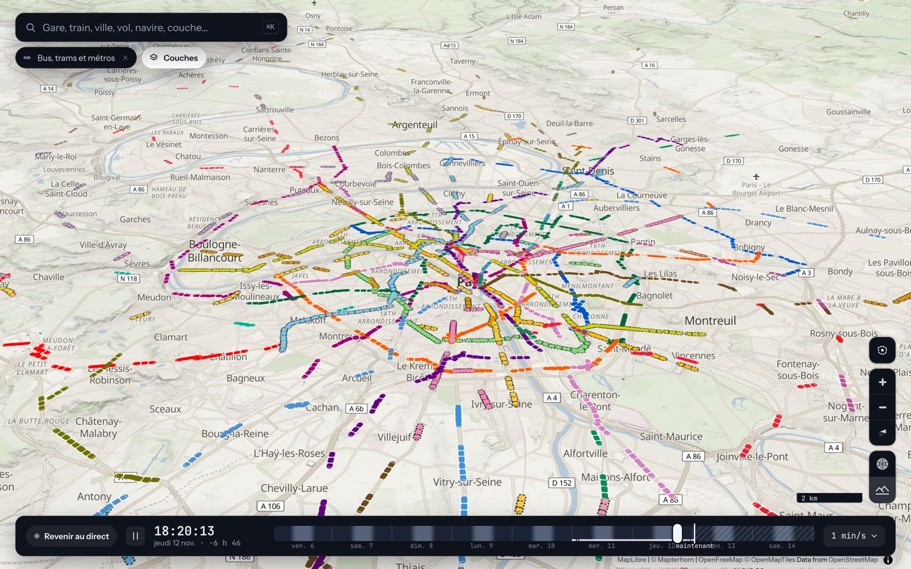
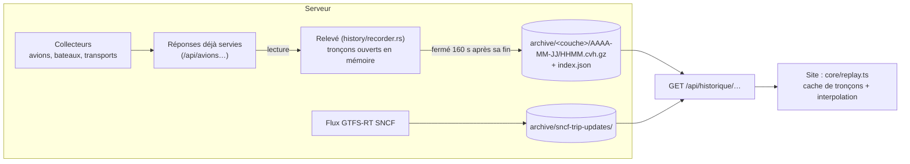

# Historique et relecture

Remonter la frise du temps rejoue le passé : le serveur enregistre ce que montrent les couches mobiles, et le site le relit quand l'horloge est à plus de 2 minutes dans le passé (`REPLAY_AFTER_MS` dans `web/src/core/replay.ts`).

L'enregistrement n'a lieu que si `ARCHIVE_DIR` est défini ; les variables `HISTORIQUE_JOURS` et `ARCHIVE_SNCF_JOURS` règlent la conservation (voir [deploiement.md](deploiement.md#variables-denvironnement)). Les sections suivantes sont reprises de l'ancien README ; le format exact est décrit dans `server/src/history/codec.rs`.

Avec `ARCHIVE_DIR` défini (c'est le cas dans le conteneur : `/archive`), le serveur enregistre ce que montrent les couches mobiles, et le site le relit quand l'horloge est à plus de 2 minutes dans le passé.

- **Ce qui est enregistré** : les positions que le serveur sert déjà, sans second contact avec les sources. Avions (`archive/avions/`), bateaux (`archive/bateaux/`), bus, trams et métros, positions estimées comprises et marquées comme telles (`archive/transports/`). Les trains ne sont pas enregistrés position par position : le site calcule leur position d'après les horaires, et l'archive du flux GTFS-RT donne les retards connus à chaque instant.
- **Format** (`server/src/history/codec.rs`, qui le décrit en détail) : un tronçon par couche et par tranche de 10 minutes, `archive/<couche>/AAAA-MM-JJ/HHMM.cvh.gz`, plus un `index.json` par jour. Colonnes (tous les instants, puis toutes les longitudes…), entiers quantifiés (cent-millièmes de degré, paliers de 25 ft…), codés en différences avec prédiction linéaire des positions, identité des objets (indicatif, nom du navire, ligne…) écrite une fois par tronçon, répétitions d'un objet immobile fusionnées, puis gzip. Chaque tronçon est autonome pour l'interpolation (il porte le dernier point d'avant son début et le premier d'après sa fin) et immuable une fois fermé. Un tronçon est fermé 160 s après sa fin et écrit via un fichier temporaire renommé : un arrêt brutal ne perd que les tronçons ouverts (10 à 13 minutes).
- **Conservation** : `HISTORIQUE_JOURS` (7 par défaut, comme la frise). Les jours entièrement plus vieux sont supprimés toutes les heures (il reste donc jusqu'à 8 jours sur le disque). L'archive brute `sncf-trip-updates` (environ 120 Mo par jour) est gardée plus longtemps : `ARCHIVE_SNCF_JOURS`, 180 jours par défaut (soit ~22 Go), 0 pour la garder sans limite.
- **Volume** : voir [deploiement.md](deploiement.md#mémoire-disque-et-réseau). Le relevé n'écrit que dans son propre sous-dossier par couche et ne ralentit jamais les collecteurs (tâche séparée, lecture de la réponse déjà servie).
- **API** : `GET /api/historique` (plages enregistrées par couche : tout le reste est un trou), `GET /api/historique/{couche}/{début}` (tronçon, `Content-Encoding: gzip`, cache d'un an s'il est fermé), `GET /api/historique/trains?from=&to=&at=` (comme `/api/trains`, avec les retards annoncés par la SNCF à l'instant `at`, d'après la dernière version archivée du flux qui ne le dépasse pas ; au-delà de 20 min d'écart, horaires prévus).
- **Sur le site** : filet clair sous la frise là où il y a un enregistrement ; les statuts disent « En direct » ou « Relecture du 9 nov. à 18:05 » ; sans enregistrement, la couche se masque (« Pas d'enregistrement avant le 10 nov. à 21 h »). Les fiches, la sélection et la caméra qui suit un avion (à son altitude enregistrée) fonctionnent en relecture, et un lien partagé avec un instant passé s'ouvre en relecture.
