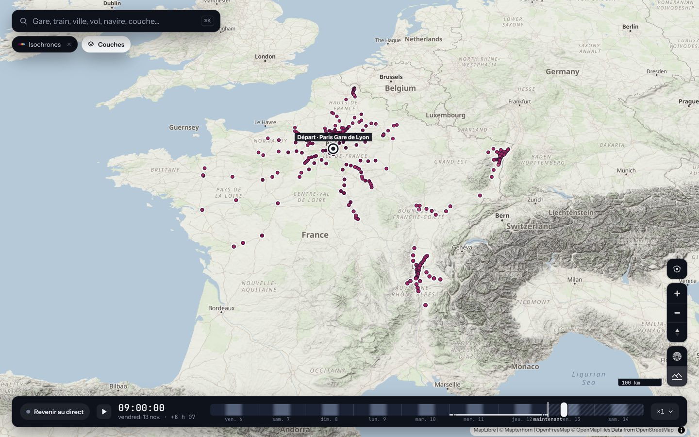
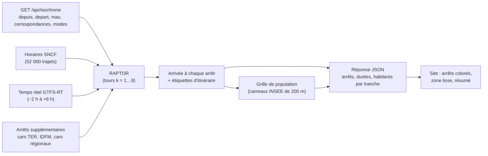

# Isochrones

La couche « Isochrones » répond à : *jusqu'où va-t-on en train, en car et en métro depuis une gare, en partant à l'heure de la frise ?* Le calcul est fait par le serveur (`server/src/raptor.rs`, `multimodal.rs`, `tiles/popgrid.rs`) et le site (`web/src/modules/isochrones.ts`) dessine le résultat.

L'API : `GET /api/isochrone` (arrivées et habitants atteints), `GET /api/isochrone/trajet` (itinéraire vers un arrêt), `GET /api/arrets/{version}` (arrêts supplémentaires, immuables et mis en cache). Les sections suivantes sont reprises de l'ancien README ; les commentaires de `raptor.rs` et `multimodal.rs` donnent le détail du code.

Le serveur (`server/src/raptor.rs`) utilise **RAPTOR** (Round-bAsed Public Transit Optimized Router), un algorithme de calcul d'itinéraires en transports en commun :

1. les trains qui desservent les mêmes gares dans le même ordre forment une **ligne** (8 700 lignes pour 52 000 trajets) ; sur une ligne, le premier train qu'on peut prendre est aussi celui qui arrive le plus tôt, une recherche dichotomique le trouve ;
2. on procède par **tours** : le tour *k* donne la meilleure arrivée à chaque gare avec au plus *k* trains. Un tour reprend les gares améliorées au tour précédent, monte dans le premier train possible de chaque ligne qui y passe, le suit jusqu'au terminus en notant chaque arrivée qui bat les précédentes, puis ajoute les correspondances à pied ;
3. chaque amélioration garde une étiquette (« train 6607 pris à Paris », « à pied depuis… »), qui permet de **remonter l'itinéraire** tour par tour. Le nombre de correspondances est un résultat du calcul, pas une pénalité.

Les choix de modélisation : une gare est une zone d'arrêt (tous les quais ensemble) ; une correspondance dans la même gare demande 8 minutes pour un train (5 pour un car, 4 pour le métro : le plus long des deux modes s'applique), sauf au départ ; deux gares à moins de 1,2 km sont reliées à pied (3 min de marge, plus 1,3 × la distance à 4,5 km/h), une gare et un arrêt de car ou de métro à moins de 1 km, deux de ces arrêts à moins de 500 m. Le **temps réel** (retards, suppressions) est appliqué aux trains quand l'heure de départ est entre 2 h avant et 6 h après maintenant ; ailleurs, l'horaire théorique.

**Multimodal.** RAPTOR ne sait pas ce qu'est un train : il reçoit des arrêts, des lignes et des marches. Les gares SNCF gardent leurs indices (le réseau partagé avec la couche des trains ne change pas) ; des **arrêts supplémentaires** les suivent, servis à part sous `GET /api/arrets/{version}` (immuable, en cache, ~3 Mo avant compression) : les réponses d'isochrone ne portent que leurs numéros. Chaque ligne a un groupe de modes (`train`, `car`, `idf`) que la requête choisit (`&modes=train,car,idf`, défaut : tout). Sources, chargées en tâche de fond (le serveur répond en rail seul dès le démarrage, puis se met à jour à chaque étape) : les **Car TER** du GTFS SNCF (~1 000 courses sur la fenêtre), le **métro, RER, Transilien et tramway** du GTFS d'Île-de-France Mobilités (même fichier que les positions estimées, ~67 000 courses ; les TER qu'il recopie et les bus sont écartés), et les **cars interurbains** de 57 réseaux du catalogue transport.data.gouv.fr (BreizhGo, Aléop, liO, Fluo, Rémi, Mobigo, ZOU !, Nomad, départements…, ~41 000 courses). Choix des réseaux régionaux : jeux de type `public-transit` dont le titre contient « interurbain » (sans agrégats, trains, bateaux, TAD, scolaires, Île-de-France) ; lignes de type bus ou car hors scolaire et à la demande ; circulations d'au moins 8 km de bout en bout avec un arrêt tous les 500 m ou plus (écarte les lignes urbaines que ces jeux contiennent). Les calendriers sont réduits à hier–dans 3 jours (départs jusqu'à après-demain). Les arrêts d'Île-de-France sont rattachés aux gares SNCF par proximité (300 m) et nom, les cars TER par code UIC, et les arrêts de cars de même nom à moins de 200 m sont fusionnés. Les temps fixes de 20 à 45 min entre terminus parisiens ne valent plus que « Trains seulement » et « Trains et cars » : avec Île-de-France, on prend le vrai métro ou RER. `GET /api/isochrone?depuis=<code UIC>&depart=<secondes>&max=<minutes>&correspondances=<n>&modes=<…>` répond en 3 à 15 ms (de 1 à 4 ms en rail seul) ; `/api/isochrone/trajet?…&vers=<code UIC ou xN>` donne l'itinéraire (étapes avec ligne, destination et couleurs officielles).

**Habitants atteints.** La réponse porte aussi `population` : le total des habitants à portée et leur répartition par tranche de 30 min (`bands`, `bandMinutes`). Règle (`server/src/tiles/popgrid.rs`) : un carreau INSEE de 200 m compte si, pour au moins un arrêt atteint, *arrivée à l'arrêt + marche de l'arrêt au centre du carreau ≤ durée demandée*. La marche reprend celle des correspondances à pied : 4,5 km/h sur la distance à vol d'oiseau × 1,3, plafonnée à 1,2 km autour d'une gare et 1 km autour d'un arrêt de car ou de métro, sans la marge de 3 min ; les carreaux autour de la gare de départ comptent. C'est un minimum : ni bus urbains, ni vélo. La grille tient en mémoire en ~16 Mo (2,29 M de carreaux métropolitains : un octet de position dans une case de 1 km, un `f32` d'habitants, un index de cases) ; chaque arrêt ne visite que les cases que son disque de marche touche. Surcoût mesuré : de 0,1 à 0,7 ms par requête usuelle (`&habitants=non` le supprime pour le mesurer). Le site l'affiche dans le résumé (« … 1,2 million d'habitants à moins de 3 h ») et dans la fiche de la gare de départ.

Variables d'environnement : `ISO_CARS_TER`, `ISO_IDF`, `ISO_CARS_REGIONAUX` (`non` pour désactiver une source), `ISO_CACHE_MO` (cache des GTFS régionaux, `transit-interurbain/`, 800 par défaut ; ~520 Mo utilisés), `ISO_MEMOIRE_MO` (budget des cars régionaux, 80). Aucune clé d'API n'est nécessaire.
