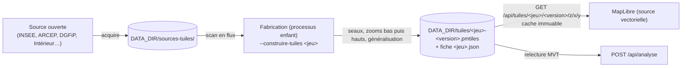
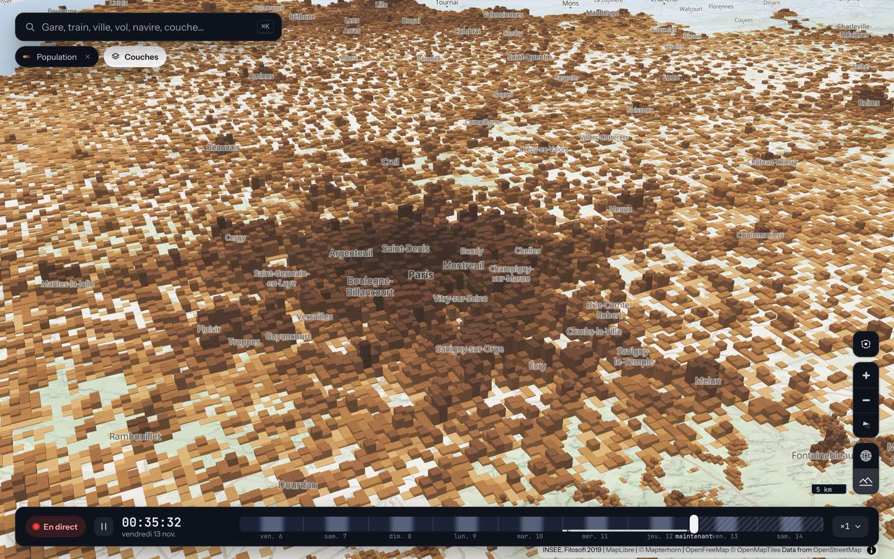

# Moteur de tuiles

Les gros jeux de données (2,3 millions de carreaux de population, 3,7 millions de ventes immobilières, des polygones de couverture mobile ou de bureaux de vote) ne se téléchargent pas dans le navigateur : le serveur (`server/src/tiles/`) les prépare **une fois**, les **généralise par zoom** et les sert en **tuiles vectorielles**. C'est un moteur réutilisable ; chaque couche « gros volume » est un jeu de données du moteur.

Trois jeux et sept scrutins sont en service : `population`, `couverture`, `dvf`, et `elec-p22t1`, `elec-p22t2`, `elec-eu24`, `elec-l24t1`, `elec-l24t2`, `elec-m26t1`, `elec-m26t2` (`tiles/serve.rs`, fonction `datasets()`). Au démarrage, le serveur fabrique en tâche de fond toute archive manquante, une à la fois.

Les 2,3 millions de carreaux de population de l'INSEE ne se téléchargent pas dans le navigateur : le serveur (`server/src/tiles/`) les prépare **une fois**, les **généralise par zoom** et les sert en **tuiles**. C'est un moteur réutilisable ; la couche « Population » est son premier jeu de données.

- **Format** : tuiles Mapbox Vector Tiles (MVT, du protobuf écrit à la main : `mvt.rs`), rangées dans une archive **PMTiles v3** (`pmtiles.rs` : numéros de tuile de Hilbert, répertoires racine et feuilles, tuiles identiques stockées une fois, gzip) avec son lecteur.
- **Fabrication à mémoire bornée** (`builder.rs`) : la source est lue en flux et déposée dans des fichiers « seaux » (une tuile du zoom 10 chacun) ; les zooms bas (4 à 9) sont faits en un passage global, qui agrège au fil de l'eau ; les zooms hauts (10 à 12), seau par seau. Elle tourne dans un **processus enfant** du serveur (`carte-vivante-serveur --construire-tuiles <jeu>`) : toute sa mémoire est rendue à la fin. Tant qu'elle tourne, l'ancienne archive reste servie ; elle n'est refaite que si le millésime de la source ou le schéma change. Résultat dans `DATA_DIR/tuiles/` (archive, fiche `<jeu>.json`, fichiers annexes), source téléchargée dans `DATA_DIR/sources-tuiles/<jeu>/`.
- **Généralisation par zoom** : carreaux → carreaux plus gros (`GridAggregator` : les **comptes sont additionnés, les ratios recalculés** à partir des sommes, jamais moyennés) ; points → grappes (`PointCluster`) ; polygones → découpés au carré de la tuile plus 64 unités de marge et simplifiés à la résolution de la tuile (Douglas-Peucker, `geom.rs`), ceux de moins d'un pixel sont écartés. Une tuile ne dépasse pas 500 Ko (non compressée) : au-delà, les objets les moins importants (`Feature::weight`) sont retirés et un avertissement est journalisé.
- **Service** : `GET /api/tuiles/<jeu>` (fiche : version, zooms, emprise, crédit, plages de valeurs pour les légendes ; jamais en cache) et `GET /api/tuiles/<jeu>/<version>/{z}/{x}/{y}` (une tuile gzippée, **cache immuable d'un an** : une nouvelle fabrication change de version, donc d'adresse). *Pourquoi servir les tuiles par le serveur plutôt que le fichier `.pmtiles` avec des requêtes `Range` et le paquet npm `pmtiles` ?* Le site reste une source MapLibre ordinaire sans dépendance de plus ; le format d'archive reste interne au serveur ; l'adresse versionnée donne le cache immuable. Le prix (le serveur lit chaque tuile non encore en cache, un `pread` de quelques Ko) est négligeable à cette échelle.
- **Site** : `web/src/map/vectorTiles.ts` (fiche, source MapLibre) ; le module met ses couches `fill-extrusion` (3D) et `fill` (à plat) sous les étiquettes, un clic ouvre la fiche commune.

### Ajouter un jeu de données

1. Créer `server/src/tiles/mon_jeu.rs` avec un type qui implémente `Dataset` (voir le commentaire de module de `tiles/mod.rs` et l'exemple `population.rs`) : `id`, `layer`, `keys` (propriétés), `zooms`, `source_id` (millésime de la source), `acquire` (téléchargement), `scan` (lecture **en flux**, un `emit(Feature)` par point, polygone ou carreau, avec ses propriétés) et `generalizer(zoom)` : `PassThrough` pour des polygones, `PointCluster` pour des points, `GridAggregator` pour une grille.
2. L'ajouter dans `datasets()` de `tiles/serve.rs`. Au démarrage, le serveur fabrique l'archive en tâche de fond si elle manque.
3. Côté site : `loadTileSheet('<jeu>')` dans le `load()` du module, `addTileSource` et des couches MapLibre (`source-layer` = `sheet.couche`) dans `native` ; la fiche vient de `select`/`describe`.

Pour des **polygones** (couverture mobile, bureaux de vote) : ne fabriquer que les zooms où le jeu a un sens (`zooms().0`), car aux zooms bas tous les polygones passent en mémoire. Pour des **points** (prix de l'immobilier) : la dernière propriété est le nombre de points d'une grappe.

## Population (carreaux INSEE)

Couche « Population » : les habitants au carreau de 200 m (Filosofi 2019, INSEE, licence ouverte Etalab 2.0), France métropolitaine, Martinique et La Réunion (les seuls départements d'outre-mer du fichier). Hauteur de la colonne = densité (racine carrée) ; couleur au choix : densité, niveau de vie moyen, part de ménages pauvres, part des 65 ans et plus ; mode « à plat ». Une teinte, sept classes, seuils calculés par le serveur sur la distribution **des habitants** (palette validée sur fond clair et sombre).

La source (zip de 58 Mo qui contient un 7z qui contient trois CSV) est lue en flux : l'identifiant d'un carreau (`CRS3035RES200mN2029800E4252400`) donne sa position dans le repère LAEA (EPSG:3035) ; la Martinique et La Réunion sont en UTM (`tiles/proj.rs`, projections écrites à la main). **Secret statistique** : sous 11 ménages fiscaux, l'INSEE publie une valeur *imputée* (approchée), signalée par `i_est_200` ; c'est le cas de 79 % des carreaux (mais de 20 % des habitants : les carreaux ruraux). La fiche donne la part d'habitants concernée. Variables d'environnement : `INSEE_CARREAUX_URL` (millésime par défaut : 2019), `TUILES_EFFACER_SOURCES` (effacer la source après la fabrication), `TUILES_JEUX` (ne mettre en service que certains jeux, ex. `population,dvf`). Les fabrications passent une par une, tous jeux confondus.

## Couverture mobile (ARCEP, polygones rastérisés)

Couche « Couverture mobile » : où l'on capte, opérateur par opérateur (Orange, SFR, Bouygues Telecom, Free Mobile), en 4G ou en voix (2G/3G), et combien d'opérateurs couvrent chaque endroit, zones blanches comprises. Source : ARCEP, « Mon réseau mobile », cartes de couverture théorique du dernier trimestre (2026 T2), <https://data.arcep.fr/mobile/couvertures_theoriques/> (jeu <https://www.data.gouv.fr/datasets/mon-reseau-mobile>), Licence Ouverte ; à citer « ARCEP, Mon réseau mobile ». Ce sont des **simulations** des opérateurs, publiées sous le contrôle de l'ARCEP : pas des mesures. La 5G n'est pas publiée par l'ARCEP, et la 2G de Free Mobile non plus (d'où « voix = 2G/3G ») ; l'outre-mer n'est pas pris en compte.

**Volumes.** Huit GeoPackage en 7z (4G et 2G/3G voix × 4 opérateurs) : 2,1 Go à télécharger, ~6 Go décompressés (une ligne par département et niveau de qualité, géométries de 1 à 40 Mo en Lambert-93). Le serveur les télécharge l'un après l'autre (`acquire`), puis, dans le processus de fabrication, décompresse chaque fichier, le lit (SQLite embarquée, `rusqlite`), le rastérise, et **efface le 7z et le GeoPackage** aussitôt : jamais plus d'un fichier décompressé sur le disque. Les contours des départements (Etalab, 2,7 Mo) servent de masque de terre.

**Rastérisation** (`server/src/tiles/couverture.rs`, commentaires de module : remplissage par lignes de balayage expliqué). Grille de 250 m en LAEA (comme les carreaux INSEE, donc un `Cell` ordinaire : aucun changement du moteur), un octet par carreau et par technologie (2 bits par opérateur : aucune, limitée, bonne, très bonne), ~4 400 × 4 500 carreaux, 37 Mo. Les sommets sont lus un à un dans le blob WKB, projetés (Lambert-93 vers LAEA, par interpolation bilinéaire d'un quadrillage de 5 km), et seuls les croisements avec les lignes de centres de carreaux sont gardés. Les carreaux de terre sans couverture sont émis aussi : ce sont les zones blanches. Aux zooms bas, `GridAggregator` additionne des comptes (niveaux, « couvert », « zone blanche ») par carreau agrégé (de 250 m au zoom 11 à 32 km au zoom 4, ~6 pixels d'écran à chaque zoom) et `finalize` recalcule la qualité moyenne, la part de surface couverte par opérateur, le nombre moyen d'opérateurs et la part sans opérateur.

**Mesures** (Mac, un cœur, fabrication complète) : ~6 min de fabrication hors téléchargement (rastérisation des 8 fichiers : 3 min), archive de 111 Mo (4 574 tuiles), pointe de mémoire du processus enfant ~100 Mo (< 150 Mo), serveur principal inchangé en régime établi. Variables d'environnement : `ARCEP_OPERATEURS` (codes `OF,SFR0,BOUY,FREE`), `ARCEP_TECHNOS` (`4g,voix`) et `ARCEP_DEPARTEMENTS` (`29,22`) pour un essai réduit (elles entrent dans l'identifiant de la source) ; `ARCEP_GARDER_SOURCES` garde les 7z ; `TUILES_JEUX=couverture`. Pour changer de trimestre : `QUARTER` dans `couverture.rs`.

Côté site (`web/src/modules/couverture.ts`) : à plat, technologie (4G, voix) et vue (nombre d'opérateurs, ou un opérateur). Une seule teinte (vert olive, ni les couleurs des opérateurs ni celles des autres couches), la **carence la plus visible** : zéro opérateur ou aucune couverture est le cran le plus foncé de jour, le plus clair de nuit ; palette validée (`validate_palette.js --ordinal`, jour et nuit). Fiche : opérateurs en 4G et en voix, niveau de chacun, date des cartes, rappel « simulations, pas mesures ». Scène « Réseau mobile ».

**Habitants sans 4G** (croisement avec la population). La fabrication de `couverture` lit la grille compacte de `population` (`population-grille-<version>.bin`, écrite par sa propre fabrication : `Dataset::depends_on` fait attendre la couverture, **sans** tenir la file des fabrications). Chaque carreau de population de 200 m est rattaché au carreau de couverture de 250 m qui contient son **centre** (même convention que la rastérisation : un carreau est entièrement couvert ou non, jamais partagé), les habitants sont accumulés en quarts d'habitant dans une grille `u16` de 38 Mo (+38 Mo de pointe pour la fabrication), et trois comptes entrent dans les tuiles : `hp` (habitants), `h0` (ceux d'un carreau sans 4G), `h1` (un seul opérateur 4G), additionnés par `GridAggregator` comme tout compte. Mesures nationales (4G, trimestre 2026 T2, population Filosofi 2019 : 62,97 M d'habitants métropolitains) : **62 560 habitants sans aucun opérateur 4G (0,10 %)**, 6 651 avec un seul (0,01 %), 18 235 avec deux, 104 226 avec trois, 62,78 M avec les quatre. Côté site : vue « Habitants sans 4G » (densité de personnes sans 4G par km², `step` sur `['zoom']` car le côté des carreaux change avec le zoom), les chiffres nationaux dans le résumé, les habitants du carreau dans la fiche. Ce sont des **cartes théoriques** des opérateurs : elles surestiment ce que l'on capte vraiment (les chiffres publiés de l'ARCEP sur la couverture « mesurée » sont plus bas) ; je n'ai pas pu comparer ces 99,9 % à un chiffre publié.

## Prix de l'immobilier (DVF)

Couche « Prix de l'immobilier » : prix de vente au m² des logements, France métropolitaine (Alsace-Moselle absente du fichier, DOM écartés), 5 dernières années complètes (2021-2025 ; l'année courante s'ajoute si Etalab la publie). Source : DVF géolocalisées d'Etalab (`files.data.gouv.fr/geo-dvf/latest/csv/<année>/full.csv.gz`, ~110 Mo par an), licence ouverte 2.0, mention « DGFiP, DVF ; Etalab ». Jeu `dvf` du moteur de tuiles (`server/src/tiles/dvf.rs`, source et nettoyage dans `dvf_source.rs`, tout y est commenté).

- **Carte** : de loin (zoom < 14), des carreaux de 32 km à 100 m (~10 pixels d'écran à chaque zoom) colorés par la **médiane** du prix au m², palette divergente autour d'une médiane de référence (bleu moins cher, gris autour de la médiane, rose plus cher ; validée jour et nuit) : par défaut celle de la **zone affichée** (médiane des carreaux à l'écran pondérée par leur nombre de ventes, recalculée quand la carte s'arrête), sinon la médiane nationale du type choisi (réglage « Référence ») ; à Paris, tout dépasse 2,8 fois la médiane nationale ; de près (zoom ≥ 14), une vente par point. Réglages : biens (tous, appartements, maisons), période (5 ans, 12 derniers mois jusqu'au dernier mois publié), affichage à plat ou en relief (hauteur = densité de ventes). Fiche d'un carreau : médiane, quartiles, nombre de ventes, période, répartition appartements/maisons ; fiche d'une vente : prix, surface, pièces, mois, écart à la médiane nationale ; lien vers l'explorateur officiel (`explore.data.gouv.fr/fr/immobilier`).
- **Une médiane ne s'additionne pas** : un carreau de zoom bas rassemble des centaines de carreaux plus fins. Chaque carreau porte donc un *histogramme* de 128 classes de prix au m² espacées en logarithme (300 à 30 000 €/m², précision de la médiane ~2 %), par type et par période ; les histogrammes se fusionnent en s'additionnant, et la médiane et les quartiles ne sont lus qu'à la fin (`finalize`). En mémoire, ils sont creux (triplets carreau/classe/décompte de 12 octets, fusionnés sur place).
- **Nettoyage** (règles complètes en tête de `dvf_source.rs`) : une vente s'étale sur plusieurs lignes (parcelles, lots) au même prix, on regroupe les lignes consécutives d'une mutation ; on garde les « Vente » à une disposition, avec **un seul** logement (maison ou appartement), sans local commercial, prix ≥ 10 000 €, surface bâtie de 9 à 400 m² (appartement) ou 20 à 600 m² (maison, au plus 1 ha de terrain), prix au m² de 300 à 30 000 €, avec coordonnées. Comptes par année dans la fiche du jeu (`/api/tuiles/dvf`) : en 2021, 1,73 M de mutations lues, 885 707 ventes gardées (417 590 appartements, 468 117 maisons) ; 3 753 107 ventes pour 2021-2025.
- **Conditions de réutilisation de la DGFiP** (art. R112 A-3 du LPF) : pas de ré-identification des personnes, pas d'indexation par les moteurs de recherche. Mesures : aucune adresse, aucun identifiant de mutation ou de parcelle ; date réduite au **mois** ; position des ventes **arrondie à ~20 m** ; ventes de plusieurs biens écartées ; données servies seulement en tuiles binaires avec l'en-tête `X-Robots-Tag: noindex, nofollow, noarchive` (sur toutes les tuiles).
- **Fabrication** : les fichiers bruts sont téléchargés un à un, nettoyés en flux puis supprimés (au plus ~120 Mo bruts sur le disque) ; il reste ~25 Mo par année dans `DATA_DIR/sources-tuiles/dvf/`. Etalab publie en avril et en octobre environ : l'archive est refaite chaque semestre (`source_id`), les fichiers ne sont retéléchargés que si leur date de modification a changé. Archive : 180 Mo, 175 622 tuiles (aucune au plafond de 500 Ko).

## Élections (polygones par bureau de vote)

Couche « Élections » : présidentielle 2022 (1er et 2nd tour), européennes 2024, législatives 2024 (1er et 2nd tour), municipales 2026 (1er et 2nd tour), par bureau de vote. **Un jeu de tuiles par scrutin** (`elec-p22t1`, `elec-p22t2`, `elec-eu24`, `elec-l24t1`, `elec-l24t2`, `elec-m26t1`, `elec-m26t2`), pour garder les tuiles légères. Généralisation par niveau administratif, sans dissolution : départements (zooms 4-7), communes (8-10), bureaux (11-12) ; les totaux de chaque niveau sont les **sommes** des bureaux, les pourcentages sont recalculés dans le navigateur. Affichages : participation, « en tête » (familles politiques, légende et nom dans la fiche), part d'un candidat ; relief optionnel (hauteur = votants).

Sources : résultats définitifs par bureau (ministère de l'Intérieur, data.gouv.fr), contours des bureaux (Etalab, Licence Ouverte, approximation à partir du répertoire électoral unique, **sans valeur officielle**, datés de juin 2022), communes et départements (IGN, ADMIN EXPRESS COG CARTO, service WFS de la Géoplateforme, Licence Ouverte 2.0). Les fichiers de travail (~150 Mo) sont rangés dans `DATA_DIR/sources-tuiles/elections-sources/` ; les effacer force un nouveau téléchargement. Jointure sur `commune_bureau` (`01001_0001`), mesurée à la fabrication (bureaux / inscrits, hors Français de l'étranger, sans contour) : présidentielle 98,8 % / 98,7 %, européennes 97,7 % / 97,3 %, législatives 1er tour 97,7 % / 97,3 %, 2nd tour 97,8 % / 97,4 %. Cinq archives de 71 à 80 Mo (~380 Mo), 18 850 tuiles chacune, aucune au plafond de 500 Ko ; 1 à 2 minutes de fabrication chacune, pic de mémoire du processus enfant 138 Mo (`/usr/bin/time -l`, européennes), fichiers temporaires jusqu'à ~450 Mo pendant la fabrication. Les communes dont un bureau n'a pas de contour sont dessinées entières sous les bureaux. Pistes pour la suite (non faites) : les municipales de mars 2026 (résultats par bureau publiés par le ministère ; au niveau des listes ils sont locaux, donc plutôt la participation) et un petit point d'accès JSON pour le détail complet des 38 listes des européennes au clic (aujourd'hui, les 26 listes sous 1 % sont regroupées dans « autres »). Pour ne fabriquer que ces jeux : `TUILES_JEUX=elec-p22t1,elec-p22t2,elec-eu24,elec-l24t1,elec-l24t2`.

### Municipales 2026

Source : « Elections municipales 2026 - Résultats du premier tour » (15 mars, fichier « BV par communes », 70 000 bureaux, 35 000 communes) et « …du second tour » (22 mars, fichier « Bureau de vote », 17 000 bureaux de 1 500 communes), ministère de l'Intérieur, data.gouv.fr, **Licence Ouverte 2.0**. Publiés « sous réserve des recours devant le tribunal administratif et d'éventuelles rectifications » : la fiche le dit. Les deux tours sont là ; au 2nd tour, seules les communes qui en ont eu un ont un résultat, et les départements ne totalisent qu'elles.

Les listes sont **locales** : il n'y a pas de « liste nationale » à colorer. Ce qu'on a fait :
- **Nuance.** Le ministère attribue une nuance (`LDVD`, `LUG`, `LRN`…) aux listes, mais pas à celles de la plupart des petites communes : 35 % des voix du 1er tour sont sans nuance (48 790 listes). Les 20 nuances principales ont leur colonne de tuile (`c0`…), les rares vont dans « autres », et la colonne `-` est « liste sans nuance ». Les nuances sont rangées dans les mêmes familles que les autres scrutins (légende et nom dans la fiche) ; une liste sans nuance est grise, jamais rattachée à un courant.
- **Tête.** La couleur « en tête » est celle de la nuance de la **liste** la mieux placée (pas de la nuance la plus votée : deux listes de la même nuance peuvent en dépasser une troisième). Pour un département, où il n'y a pas de liste, c'est la nuance qui a le plus de voix, hors « sans nuance ». Participation et part d'une nuance se colorent comme les autres scrutins.
- **Liste par liste.** Les noms des listes, leurs voix et leur tête de liste ne tiennent pas dans les tuiles (500 Ko au plus, 17 listes à Paris) : le serveur les écrit dans un fichier annexe (une commune par ligne, avec les voix de chaque bureau) lu à la demande, `GET /api/tuiles/elec-m26t1/objet/<code INSEE>`. La fiche d'une commune ou d'un bureau liste les 8 premières listes avec nuance, voix et part des exprimés (voix du bureau pour un bureau).
- **Contours.** Les contours des bureaux datent de juin 2022 : les bureaux créés ou renumérotés depuis n'ont pas de forme, leur commune est alors montrée entière sous les bureaux (« commune de repli », comme pour les autres scrutins).
