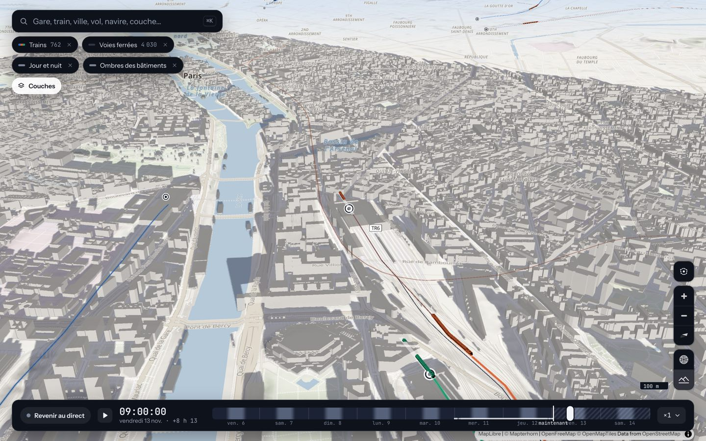
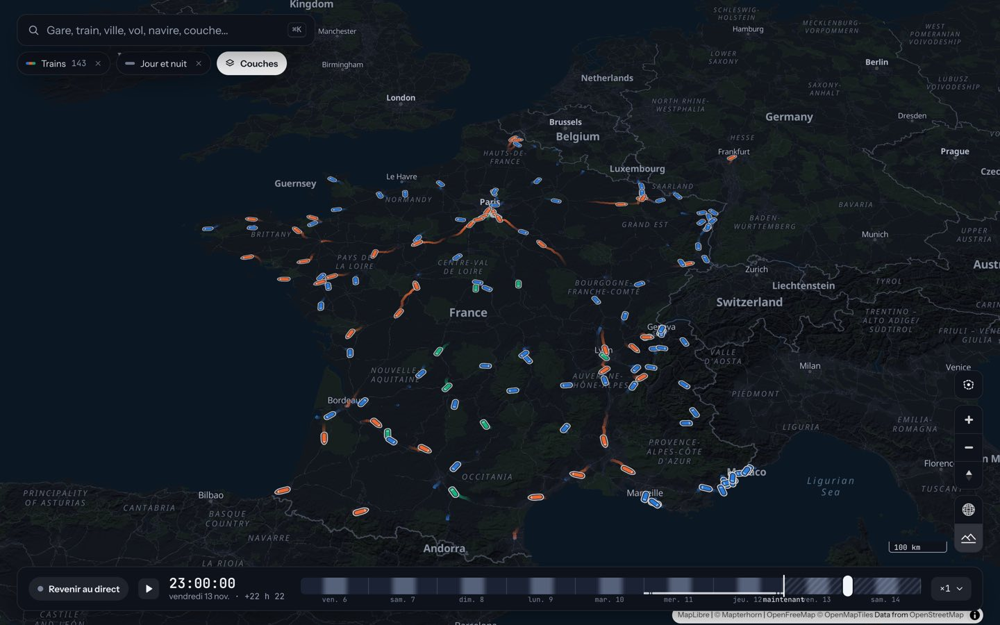
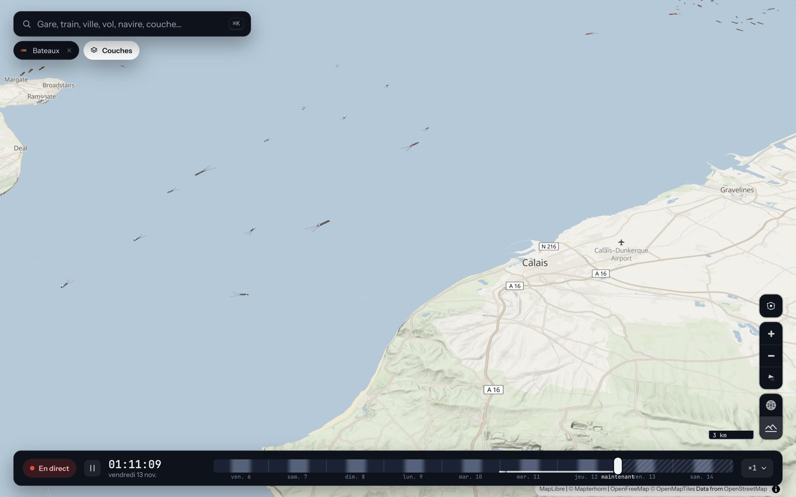
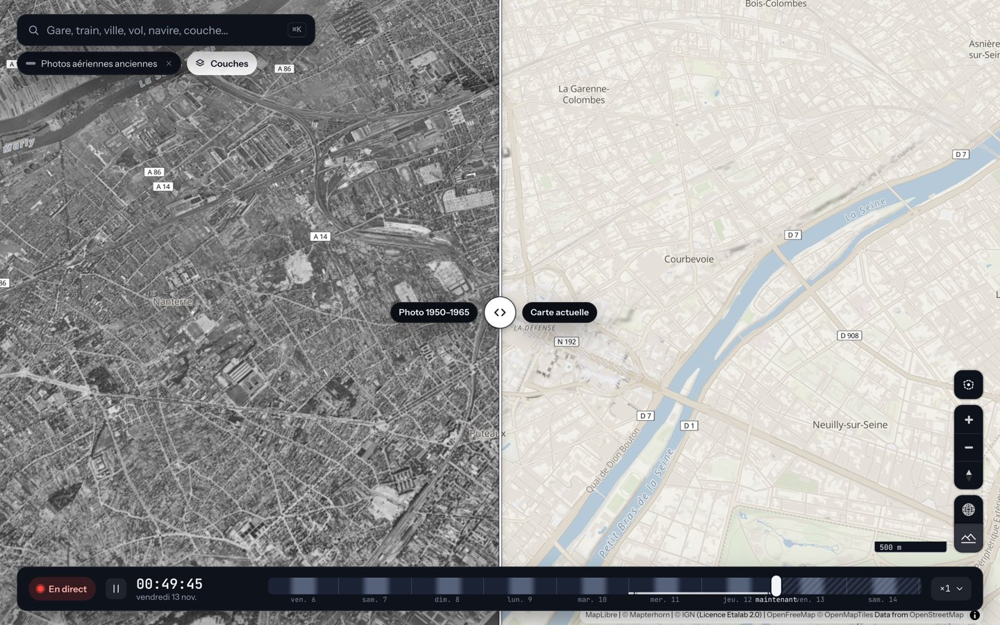

# Rendu 3D

Le rendu repose sur deux moteurs superposés dans un même contexte WebGL : **MapLibre GL JS 5.24** dessine le fond de carte, le relief, le globe et les bâtiments en extrusion, et **deck.gl 9.4** dessine les couches de données par-dessus (mode « interleaved » : les deux partagent le tampon de profondeur, donc les maquettes passent derrière le relief et les bâtiments).

## Le fond de carte, le relief et la nuit

- Le fond est le style OpenFreeMap « Liberty », retouché au chargement (`web/src/map/calmStyle.ts`) : routes en gris chaud, eau en bleu-gris, moins de libellés de loin ; la couleur reste réservée aux données. Il passe à une vraie palette sombre la nuit, selon le soleil au centre de la vue.
- Le relief vient des tuiles Mapterhorn (`raster-dem`), avec une exagération de 1,4 (`TERRAIN_EXAGGERATION` dans `map/baseMap.ts`). Avec la couche « Relief LiDAR HD » (réglage « Relief 3D »), la source du relief devient `relief-lidar` (le MNT LiDAR HD de l'IGN converti par le serveur, Mapterhorn en repli, même exagération) à partir du zoom 11 sur la France : MapLibre n'admet qu'une source de relief, `setLidarTerrain` (`map/baseMap.ts`) la change donc d'un bloc, et l'ombrage avec elle (voir `docs/couches.md`). Des erreurs 404 sur `tiles.mapterhorn.com` apparaissent dans la console : c'est normal, Mapterhorn ne fournit pas de tuiles au-dessus de l'océan.
- La couche « Jour et nuit » calcule la position du soleil (`modules/solar.ts`), teinte le fond et dessine l'ombre de la nuit et des crépuscules.

## Maquettes 3D de véhicules

Les véhicules sont des maquettes 3D de près : avions (dès le zoom 6,5), bateaux (zoom 10), trains voiture par voiture (zoom 13), bus, trams et métros (zoom 15). En deçà, ce sont des silhouettes à plat. Les maquettes sont construites dans le code (`web/src/models/`, aucun fichier à télécharger, donc aucune licence de modèle), à leurs dimensions réelles de près et agrandies jusqu'à une taille minimale à l'écran de loin. Elles passent derrière le relief et les bâtiments ; un train en tunnel reste visible en fantôme à plat. Chaque couche de véhicules a un réglage « Rendu » (maquettes 3D ou symboles à plat).

| Fichier | Rôle |
|---|---|
| `models/mesh.ts` | Petit atelier de maquettes : sections de fuseaux, boîtes, couleurs de sommets (une pièce blanche prend la couleur de la donnée, une pièce grise la fonce). Repère en mètres réels : x vers l'avant, y à gauche, z vers le haut. |
| `models/aircraft.ts` | Sept familles d'avions : biréacteur, gros-porteur, quadriréacteur, turbopropulseur, jet d'affaires, avion léger, hélicoptère. |
| `models/trains.ts` | Rames voiture par voiture (TGV à motrice effilée, TER, Intercités). |
| `models/ships.ts` | Coques selon le type AIS (porte-conteneurs, pétrolier, ferry, paquebot, pêche, voilier…). |
| `models/transit.ts` | Bus, bus articulé, tram, métro. |
| `models/meshLayer.ts` | Réglages communs de `SimpleMeshLayer` (profondeur, matière) et réglage « Rendu ». |
| `models/sunLight.ts` | Éclairage par le soleil. |

Les maquettes n'ont pas de normales : deck.gl éclaire chaque facette à plat, ce qui donne le rendu « à facettes » voulu et dispense de les calculer. Une instance par véhicule (`SimpleMeshLayer`), avec le test de profondeur activé (`depthCompare: 'less-equal'`).

## Éclairage

Le vrai soleil de l'instant affiché éclaire les maquettes (et les colonnes de la couche « Électricité ») quand la couche « Jour et nuit » est allumée : direction du soleil au centre de la vue, teinte dorée au crépuscule, clair de lune neutre la nuit (`models/sunLight.ts`). Les mêmes règles éclairent les bâtiments de MapLibre, pour qu'une maquette et l'immeuble voisin aient leur face claire du même côté. Sans la couche, un soleil fixe de plein jour est utilisé. L'effet n'est recréé que si le soleil a bougé d'un degré, parce que deck.gl redessine tout quand on change ses effets.

## Ombres des bâtiments

Calcul côté navigateur, pas par deck.gl. Les empreintes et hauteurs sont relues dans les tuiles que MapLibre a déjà chargées (`querySourceFeatures`), l'ombre de chaque bâtiment est balayée à l'opposé du soleil dans un canvas 2D, que MapLibre drape sur le relief sous les bâtiments 3D. Les effets d'ombre de deck.gl (`LightingEffect`) ne conviennent pas ici : ils demandent de redessiner les bâtiments par deck.gl, et ses couches se posent à l'altitude 0, sans suivre le relief de MapLibre. Visible à partir du zoom 14 ; le relief est ignoré dans le calcul de la longueur (l'ombre est seulement drapée sur la pente).

## Le rideau des photos aériennes

MapLibre ne sait pas découper une couche à l'écran, et avec le relief 3D ses couches raster sont dessinées dans des textures par tuile, puis plaquées sur le terrain : un masque d'écran n'y change rien. Le module (`web/src/modules/aerialCurtain.ts`) dessine donc lui-même les tuiles de l'IGN dans une **couche WebGL « custom »** : chaque tuile est un maillage de 8 × 8 cases dont les sommets prennent l'altitude affichée du relief (`queryTerrainElevation`), et un `discard` dans le shader sur `gl_FragCoord.x` fait le rideau. La couche s'intercale sous les étiquettes : noms de lieux et couches deck.gl restent par-dessus la photo. Une deuxième carte synchronisée aurait coûté un second rendu du relief et caché ces couches du côté photo. Limites : les bâtiments 3D d'aujourd'hui dépassent de la photo quand la carte est inclinée ; indisponible sur le globe.

## Pièges connus

- **MapLibre est volontairement en version 5.** deck.gl 9.4 utilise des éléments internes de MapLibre que la version 6 a renommés : la carte plante dès que le relief 3D est actif. Il faudra repasser en v6 quand deck.gl la prendra en charge.
- **Le globe et le relief ne vont jamais ensemble.** MapLibre 5 ne gère pas complètement le relief sur le globe, et faire pivoter la carte peut alors la figer. Passer au globe coupe donc le relief ; le réactiver ramène la carte à plat (`keepGlobeAndTerrainApart` dans `map/baseMap.ts`).
- **Sur le globe, les icônes et les textes de deck.gl 9.4 ne s'affichent que si l'élimination des faces arrière est coupée.** Tous les modules passent donc les paramètres communs `OVER_MAP` de `map/parameters.ts`, qui contiennent `cullMode: 'none'`.

## Performances

Mesures du dépôt (`perf/resultats-*.json`, vues fixes inclinées, rotation de 5 secondes, écran à densité 2, trains, transports et avions affichés ; `bench.mjs`) :

| Vue | Avant les optimisations : image / CPU par image | Après : image / CPU par image |
|---|---|---|
| Paris, zoom 14, inclinaison 55° | 52,6 ms / 53,7 ms | 16,9 ms / 11,5 ms |
| Lyon, zoom 15, inclinaison 60° | 59,9 ms / 60,6 ms | 17,5 ms / 13,4 ms |
| Paris, de nuit | 59,5 ms / 61,4 ms | 17,7 ms / 15,8 ms |
| Lyon, de nuit | 58,1 ms / 59,1 ms | 21,2 ms / 20,0 ms |

Les optimisations sont celles des commits `8bb8836` et `ecd3b52` (12 novembre 2026) : barre d'échelle sans lecture du GPU pendant le mouvement, altitudes du sol mémorisées, gares et véhicules posés sur le relief dans la vue seulement, altitude du sol des avions relue dans la vue seulement. Après elles, les vues de France (zoom 6) et des Alpes (zoom 11) mesurent 16,7 ms par image (soit la cadence de 60 images par seconde de l'écran) pour 3,8 ms et 8,1 ms de CPU par image. Ces mesures ont été faites sur la machine de développement ; elles montrent un ordre de grandeur, pas une garantie.

Principes appliqués dans le code :

- **Redessiner moins** : chaque module déclare un `timeStepMs` (0 pour une couche animée, sinon une durée de temps simulé ou une fonction du zoom) : redessiner toute la carte coûte cher, et un objet lent n'a pas besoin de 60 images par seconde quand il se déplace de moins d'un pixel.
- **N'envoyer que le nécessaire au processeur graphique** : seule la portion des chemins de trains proche de l'instant affiché est envoyée pour les traînées (dix fois moins de sommets).
- **Réseau mis en cache** : le réseau des trains (1,7 Mo compressés) est publié sous une version qui est l'empreinte de son contenu, donc gardé en cache par le navigateur d'une visite à l'autre.
- **Tuiles immuables** : les tuiles vectorielles du serveur ont une adresse versionnée et un cache d'un an.
